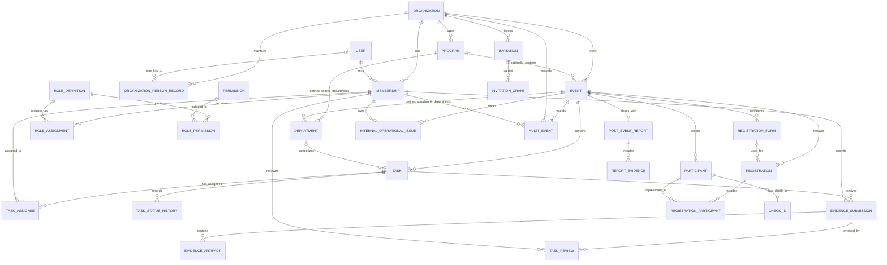

# CampusOps — Data Model & Relationship Map

**Version:** 0.1  
**Status:** Proposed logical model for founder review  
**Related documents:** `CampusOps_Requirements_Specification_v0.9.md`, `CampusOps_Role_and_Permission_Matrix_v0.1.md`, `CampusOps_Decision_Log_v0.4.md`  
**Working mode:** Product/architecture documentation only. This is not a production database schema and does not authorize application implementation.

## 1. Purpose

This document proposes how CampusOps data should be organized so that the product can support:

- An organization workspace with individual user accounts and scoped permissions.
- Two distinct setup journeys: a standalone event and a multi-event program.
- Standalone events with event-specific departments and Department Leads.
- Multi-event programs with shared program departments, Event Leads, and coordinators assigned to departments and specific work.
- Specific task deadlines, progress history, file/link evidence, review decisions and notifications.
- Native registration plus selected external registration sources.
- Individual check-in for every participant, including members of team registrations.
- Post-event documentation and consolidated program reporting.

The model preserves the user's explicit exclusions: marketing operations are out of scope, and there is no participant-facing doubts/questions/issue-submission portal. Internal operational blockers/issues among authorized staff may be recorded separately.

## 2. Modeling principles

1. **Separate a person from their access.** A `User` is a person's sign-in identity. `Membership` connects that user to an organization. Roles and permissions are granted separately and can be scoped.
2. **Do not use a shared club password.** An organization is a workspace/profile, not a login account.
3. **Keep the UI workflows distinct while reusing concepts.** A standalone event does not need a parent program. A program contains multiple child events. Both use the same underlying `Event`, task, registration and reporting concepts where appropriate.
4. **Make scope explicit.** Organization membership, program participation, event leadership, department assignment and task assignment are related but not interchangeable.
5. **Preserve individual accountability.** Task actions, evidence submissions, approvals, role changes and check-ins must be attributable to a user and timestamp.
6. **Model team registration at the person level too.** A team registration groups the entry, but each expected attendee has their own participant record and check-in state.
7. **Avoid unnecessary personal data.** Participant records are event-scoped. A workspace-wide member directory does not automatically grant access to email addresses, participant details or private records.
8. **Keep the model extensible, not speculative.** Budgets, vendor procurement, resource allocation, email provider details and other advanced capabilities can be added when requirements are validated.

## 3. Relationship map — high-level structure

**Diagram notes:**
- `EVENT.program_id` is nullable. A standalone event has no parent program; a child event points to one program.
- A `DEPARTMENT` belongs to exactly one scope: either a standalone `EVENT` or a `PROGRAM`. The database must enforce this exclusivity and verify that all related records belong to the same organization.
- The diagram is logical. Some implementation relationships (role scope, invitation grants, external record mappings, files, notifications) are shown in more detail below.

## 4. Identity, organization, and leadership data

### 4.1 `User`

Represents a person who can sign in to CampusOps.

Suggested fields:
- `id` — primary key.
- `display_name`.
- `email_normalized` — normalized and uniquely enforced according to the chosen identity policy.
- `email_verified_at` — nullable until verified.
- `account_status` — for example `pending_verification`, `active`, `locked`, `disabled`.
- `created_at`, `updated_at`, `last_login_at`.

Authentication secrets must be managed by a suitable identity provider or stored only as secure password hashes if CampusOps operates authentication itself. Passwords must never be stored in plaintext. Authentication-provider selection is not decided by this logical model.

A single person may belong to more than one organization. Removing a person's organization membership must not delete their personal account or erase history tied to that account.

### 4.2 `Organization`

Represents the club/organization workspace (for example, E-Cell ASPERA). It is not a separate login.

Suggested fields:
- `id`.
- `college_name`, `club_name`.
- `verification_status` — pending, verified, rejected, or another reviewed set.
- `verification_reviewed_at`, `verification_reviewer_id`, `verification_note` as permitted by the privacy policy.
- `created_by_user_id`.
- `created_at`, `updated_at`, `archived_at`.

The organization verification method and which actions are allowed before verification remain open. An organization name alone must not establish ownership.

### 4.3 `Membership`

Connects a `User` to an `Organization` and represents that person's membership/access in that workspace.

Suggested fields:
- `id`, `organization_id`, `user_id`.
- `membership_status` — invited, active, suspended, removed.
- `joined_at`, `removed_at`, `created_by_membership_id`.
- Unique constraint: `(organization_id, user_id)`.

A membership is not the same as a job title. One person can be an office bearer in the organization, a lead on one event, and a coordinator in a different event if the organization grants those separate assignments.

### 4.4 `OrganizationPersonRecord`

Stores the editable club roster/leadership directory introduced during organization setup. It supports office bearers and faculty coordinators even when a person has not yet accepted an invitation or created a CampusOps account.

Suggested fields:
- `id`, `organization_id`.
- `person_name`, `position_title` or `position_type` (office bearer, faculty coordinator, other configured position).
- `contact_email` if needed for organization records and permitted by policy.
- `term_start`, `term_end`, `record_status`.
- Optional `linked_user_id` / `linked_membership_id` once the person has an account and joins the workspace.
- `created_at`, `updated_at`.

**Important:** editing this roster record does not silently grant, elevate, or revoke platform access. Role and membership changes require their own authorized action and audit record. This supports annual leadership turnover without confusing contact records with accounts.

## 5. Roles, permissions, and invitations

### 5.1 `RoleDefinition`, `Permission`, and `RolePermission`

- `RoleDefinition` represents a built-in or organization-configured role template, such as Primary Workspace Administrator, Office Bearer/Core Member, Event Lead, Department Lead, Coordinator, or Registration Staff.
- `Permission` represents a specific action, such as `task.assign`, `task.review`, `registration.view`, `checkin.record`, `event.edit`, or `membership.invite`.
- `RolePermission` links a role to its allowed permissions.

Role names should not be used as the sole authorization check. Two roles may have equivalent permissions, while the same role template may have different scope assignments for different people.

### 5.2 `RoleAssignment`

Connects a `Membership` to a `RoleDefinition` within an explicit scope.

Required concepts:
- Organization membership and role.
- Scope type: organization, program, event, or department.
- Scope reference matching the scope type.
- `granted_by_membership_id`, `granted_at`, `valid_from`, optional `valid_until`, and status.

Recommended data-integrity rule: do not implement scope as an unchecked text `scope_type` plus arbitrary `scope_id`. Use database-enforced references (such as explicit nullable foreign keys with check constraints, or separate scope-specific assignment tables) and server-side validation. Validate that the role assignment, target, and user membership belong to the same organization.

Scope behavior:
- Organization-level access controls organization administration.
- Program-level access controls the parent multi-event workspace.
- Event-level access controls an assigned event.
- Department-level access controls the department assignment. For a standalone event, the department belongs to that event; for a multi-event program, a shared department belongs to the program.
- Shared program-department membership does **not** by itself grant access to every child's private participant records. Event/task access must still be authorized.

### 5.3 `Invitation` and `InvitationGrant`

An `Invitation` records an invitation sent to an intended email for a particular organization. It supports both new users and existing CampusOps users.

Suggested `Invitation` fields:
- `id`, `organization_id`, `intended_email_normalized`.
- `token_hash` (store a hash of the invitation secret, not the raw token).
- `status` — pending, accepted, expired, revoked, or declined if supported.
- `expires_at`, `created_at`, `sent_at`, `accepted_at`, `revoked_at`.
- `invited_by_membership_id`.

`InvitationGrant` describes the role and allowed scope granted on acceptance. One invitation may carry one or more grants if the product needs a person to join several relevant event/department scopes at once. Keep all grants within the same organization. The invitee must not be able to edit the invitation to grant themselves a higher role.

Acceptance flow:
1. Validate token, expiry, status and email ownership.
2. If the person has no CampusOps account, complete personal account creation and email verification.
3. If the person already has an account, require sign-in to that account; do not create a duplicate account.
4. Create or activate the organization's `Membership` and apply only the grant(s) stored in the invitation.
5. Record acceptance and audit history; mark the invitation as used so the token cannot be replayed.

Invitation expiry duration, resend behavior and the exact verification policy remain proposed until approved.

## 6. Event structure: standalone and multi-event

### 6.1 `Program`

Represents a multi-event program, such as E-Week. Suggested fields:
- `id`, `organization_id`, `name`, `description`.
- `planned_start_date`, `planned_end_date`, `status`.
- `created_by_membership_id`, `created_at`, `updated_at`.

The program provides a parent-level overview and shared departments. It does not replace individual event records.

### 6.2 `Event`

Represents one operational event. Suggested fields:
- `id`, `organization_id`, nullable `program_id`.
- `name`, `description`, `event_date`, optional planned start/end time, optional `venue` / venue record.
- `event_format` or configurable metadata where needed; solo/team registration mode must be supported by the registration setup rather than assumed globally.
- `status`, `created_by_membership_id`, `created_at`, `updated_at`, `archived_at`.

Rules:
- Standalone creation sets `program_id = NULL` and follows the standalone setup journey.
- Multi-event creation creates a `Program` and its child `Event` rows. Each child event has its own date, venue, tasks, registration/check-in data and report.
- Program overview may aggregate child status, but it must not merge the underlying source records.
- Event name/date/venue remain editable subject to permissions and audit policy.

### 6.3 `Department`

Represents a functional team such as Event Management, Sponsorship, Design, Logistics, or another configured name.

Suggested fields:
- `id`, `organization_id`, `name`, `description`, `status`.
- Exactly one of `program_id` or `standalone_event_id` must be populated.
- `created_by_membership_id`, `created_at`, `updated_at`.

Scope rules:
- Standalone event: departments belong to the specific event. A Department Lead can be assigned to that department, and can add departmental members/assign departmental work within permission.
- Multi-event program: departments belong to the program and are shared by its child events. There is no separate Department Lead per department by default. Event Leads are assigned to individual child events; coordinators can be assigned to shared departments and to specific event tasks.
- A shared department does not create one combined event. A task still belongs to one specific event, and authorization must check both the department and event scope.

## 7. Tasks, deadlines, evidence, and review

### 7.1 `Task`

Suggested fields:
- `id`, `organization_id`, `event_id`, optional `department_id`.
- `title`, `description`, `priority`, `status`.
- `created_by_membership_id`, optional `assigned_by_membership_id`.
- `due_at` or `due_date` plus optional `due_time` and timezone policy.
- `proof_required` (recommended default: true, aligned with the described workflow; whether exceptional tasks may omit proof remains to be confirmed).
- `created_at`, `updated_at`, `completed_at`, `archived_at`.

Each task belongs to one event. In a program, the task also belongs to the relevant child event, while its optional department points to one of the program's shared departments. In a standalone event, the department points to one of that event's departments. Reject mismatched event/department combinations.

### 7.2 `TaskAssignee`

A join record connecting tasks and assigned workspace members. This supports one or more owners without storing multiple users in one text field.

Suggested fields: `task_id`, `membership_id`, `assigned_by_membership_id`, `assigned_at`, `assignment_status`, optional `unassigned_at`.

Changing an assignment should preserve history. At least one clearly responsible owner should be identifiable for active work; whether multiple assignees are allowed for every task is a product decision to validate.

### 7.3 `TaskDependency` and `TaskStatusHistory`

- `TaskDependency` records a predecessor/successor relationship between tasks. Both tasks must belong to the same event or a permitted parent-program dependency scope. Prevent self-dependencies and dependency cycles.
- `TaskStatusHistory` records status transitions, actor, timestamp, and optional reason. It supports progress updates and auditability rather than keeping only the latest status.

Recommended statuses: `Not started`, `In progress`, `Blocked`, `Awaiting review`, `Changes requested`, `Completed`, and `Cancelled` if cancellation is supported. Final values must be standardized in the PRD.

### 7.4 `EvidenceSubmission` and `EvidenceArtifact`

`EvidenceSubmission` represents a submitted attempt to prove a task is complete.

Suggested fields:
- `id`, `task_id`, `submitted_by_membership_id`, `submitted_at`.
- `submission_number` or version number.
- `submitter_note`, `submission_status` (pending review, approved, changes requested).

`EvidenceArtifact` represents one item in a submission. It contains either:
- a `FileObject` reference, or
- an approved external URL (HTTPS initially),

but not both in the same artifact row. A submission can contain one or more artifacts unless the validated UX requires exactly one.

`FileObject` stores metadata, not the file bytes directly: storage key, original filename, detected media type, byte size, checksum, uploader, upload timestamp, scan status and retention state. Files must be access-controlled; the database should not expose permanent public storage URLs for private evidence.

### 7.5 `TaskReview`

Records an approval or request for changes against a specific evidence submission.

Suggested fields:
- `id`, `evidence_submission_id`, `reviewer_membership_id`.
- `decision` — approved or changes requested.
- `review_note`, `reviewed_at`.

State rules:
- The assignee cannot directly set a proof-required task to `Completed`.
- Submitting proof moves the task to `Awaiting review`.
- An authorized reviewer approves or requests changes.
- Approval moves the task to `Completed`.
- A request for changes leaves the task non-completed, preserves the prior submission/review history, records the note, and notifies the responsible assignee(s).
- A user must not approve their own evidence by default, even if they also have a lead role. Any alternative for very small teams requires an explicit, auditable policy decision.

## 8. Registration, participants, and individual check-in

### 8.1 `RegistrationForm`

Represents the form configuration for a specific event. It supports native form fields and may refer to an external source configuration where appropriate.

Suggested fields: `id`, `event_id`, `form_name`, `status`, `form_definition_version`, `created_by_membership_id`, `created_at`, `updated_at`.

Form question/field definitions can be stored in a normalized question/option structure or a validated schema document. The specific choice should be made during technical design after validation needs and edit/version requirements are known.

### 8.2 `Registration`

Represents an individual registration submission or a group/team registration. Suggested fields:
- `id`, `event_id`, optional `registration_form_id`.
- `registration_type` — individual or team.
- `registration_status` — submitted, confirmed, cancelled, waitlisted, or another validated lifecycle.
- `team_name` or team reference where relevant.
- `source_type` — native or external.
- `submitted_at`, `source_record_id` where relevant, and audit timestamps.

A team registration is a grouping/entry, not a single attendance record for all members.

### 8.3 `Participant` and `RegistrationParticipant`

`Participant` represents one person as an attendee of one event. Keeping attendee records event-scoped avoids automatically creating a cross-event personal profile and reduces unnecessary data sharing.

Suggested `Participant` fields:
- `id`, `event_id`, participant name and the minimum event-required contact/eligibility details.
- `participant_status`, `created_at`, `updated_at`.
- External source identifiers should live in a mapping table rather than being the sole participant key.

`RegistrationParticipant` links a registration to each individual participant. For an individual registration there is normally one linked participant; for a team registration there are multiple linked participants. Team membership is explicit and each linked participant has a separate check-in status.

Do not assume email alone uniquely identifies a person: family/shared emails, typos and multiple submissions are possible. Define duplicate handling and manual reconciliation before production use.

### 8.4 `CheckIn`

Records an individual participant's attendance at an event.

Suggested fields:
- `id`, `event_id`, `participant_id`.
- `check_in_status`, `checked_in_at`, `checked_in_by_membership_id`, `station_id` if stations are later required.
- `method` (for example QR scan or manual lookup), optional override reason, created/updated timestamps.

Critical constraints:
- A participant must belong to the same event as the check-in record.
- Enforce at most one current successful check-in per participant per event, with a safe/idempotent handling of duplicate scans.
- A solo registration maps to an individual participant record.
- A team registration maps to its team entry plus distinct participant records for every member expected to attend.
- Checking in the team name must never automatically mark every member present.
- Attendance totals are derived from valid check-in records under a documented counting rule, not trusted as a free-text number alone.
- Walk-ins and registration exceptions must be handled through an authorized, auditable path; policy should clarify when a walk-in creates a new registration/participant record.

### 8.5 External registration integration (conditional until provider selection)

If an external provider such as Google Forms is supported, model it through explicit integration records rather than embedding provider-specific fields into every core table:
- `RegistrationSourceConnection` — event, provider, account/permission reference, status, configuration metadata, last successful sync.
- `ExternalRecordMapping` — provider/source record ID mapped to an internal registration or participant record, with uniqueness to prevent duplicate imports.
- `SyncRun` — started/finished timestamps, result, count summary and sanitized error details.

Never store provider secrets in ordinary event records. Define field-level source of truth, import/update rules, idempotency, conflict review, retries and disconnect behavior before promising the integration. The first provider is not yet finalized.

## 9. Post-event documentation, internal issues, notifications, and audit

### 9.1 `PostEventReport`

Represents the formal close-out record for an event. Suggested fields:
- `id`, `event_id` (unique if the product supports one current report per event; revisions can be separate versions).
- actual start/end or duration, venue snapshot if useful, summary, lessons learned, completed-by membership, status and timestamps.
- registration and attendance values should primarily be calculated from source records. If the report stores a frozen snapshot, record when it was calculated and what source/counting rules were used.

### 9.2 `ReportEvidence`

Connects the post-event report to photographs, documents or approved links. It should reuse the secure `FileObject` and link-validation approach, with access and retention policy appropriate to the organization.

### 9.3 `InternalOperationalIssue`

This is for an authorized team member to record an internal operational blocker that needs ownership/resolution (for example, a room is unavailable or required equipment is missing). Suggested fields: `event_id`, title/description, priority, status, owner membership, reported-by membership, timestamps and resolution note.

**Scope boundary:** this is not a public participant doubts/questions/issue-submission portal. No attendee-facing issue-raising module is included in this model.

### 9.4 `Notification`

Represents an in-app notification or notification intent associated with an event: invitation created/accepted, task assignment/deadline change, proof review result, and other validated events. Suggested fields: recipient membership/user, event type, related entity, created/read timestamps and delivery status.

Email and other delivery channels may use an outbox/retry record to handle provider failures. The application database remains the source of truth; a failed email must not undo a task assignment or review decision. Do not store raw invitation tokens or credentials in notification payloads.

### 9.5 `AuditEvent`

Stores security- and operations-relevant actions with actor, organization, optional program/event scope, action type, target record, timestamp and sanitized metadata. Important actions include role/grant changes, invitations, membership removal, deadline changes, evidence review, check-in correction, external sync conflict resolution and administrator transfer/recovery.

Audit history must not store passwords, raw access tokens, or unnecessary participant data. Access to audit history itself must be permission-controlled.

## 10. Data integrity and tenant-safety invariants

The following must be enforced in the database where possible and validated in server-side authorization/business logic as well:

1. Every program, event and department belongs to exactly one organization.
2. A standalone event has no parent program; a program child event belongs to exactly one program in the same organization.
3. A department belongs to exactly one parent scope: standalone event or multi-event program, never both and never neither.
4. A task belongs to one event. A linked department must be valid for that event's standalone/program context.
5. A role assignment cannot grant access across organizations or to a scope unrelated to the user's organization membership.
6. An invitation is constrained to its intended email, organization, role grant and scope; expired/revoked/accepted tokens cannot be replayed.
7. An active task cannot become `Completed` through ordinary assignee status editing if proof review is required.
8. Evidence review must refer to a submitted evidence version, have an authorized reviewer and preserve the decision note/history.
9. A registration participant and check-in must resolve to the same event; duplicate successful check-ins are handled idempotently.
10. Registration and attendance are separate facts. Registration does not imply attendance; team registration does not imply all team members attended.
11. Workspace-wide directory visibility does not grant full access to personal contact details, task evidence, registration records or event administration.
12. Removing membership prevents future workspace access while historical actions remain attributable to the original user.
13. Deletion/archive behavior must preserve referential integrity and audit requirements; define anonymization/retention rules before real participant data is stored.
14. Cross-event reports must not double-count registrations or participants silently. Distinguish event registrations, event check-ins and unique persons across a program.

## 11. Indexing and uniqueness candidates

Final indexes depend on workload and queries, but candidates include:
- `Membership(organization_id, user_id)` unique.
- `Event(organization_id, program_id, event_date)` for workspace/event listing.
- `Department(organization_id, program_id)` and `Department(organization_id, standalone_event_id)`.
- `RoleAssignment(membership_id, scope_type, status)` and indexes for event/program scope lookups.
- `Task(event_id, status, due_at)`, `TaskAssignee(membership_id, task_id)`, and `TaskStatusHistory(task_id, created_at)`.
- `Invitation(organization_id, intended_email_normalized, status, expires_at)` and unique token-hash index.
- `Registration(event_id, registration_status, submitted_at)` and `Participant(event_id)`.
- `ExternalRecordMapping(provider_connection_id, external_record_id)` unique.
- A uniqueness rule for current successful check-in per participant/event.
- `AuditEvent(organization_id, created_at)` and appropriate event/target indexes.

Do not add indexes or database-specific optimizations before the chosen database and query patterns are finalized. Avoid indexing sensitive personal data unless necessary.

## 12. Suggested implementation sequence for the model (not a development authorization)

1. **Identity foundation:** `User`, `Organization`, `Membership`, organization verification fields, roster/person records, role definitions, permissions, assignments and invitations.
2. **Event foundation:** `Program`, `Event`, `Department`, event/program membership scopes.
3. **Task lifecycle:** `Task`, assignees, dependencies if needed, status history, evidence submission/artifacts, review records and notifications.
4. **Registration/check-in:** form configuration, registrations, event-scoped participant records, team-member linking and individual check-in.
5. **Close-out and oversight:** report, report evidence, internal operational blockers, audit events and program summaries.
6. **External registration integration:** only after selecting the provider and verifying API access, permissions, synchronization model and failure handling.

The product can still be comprehensive over time; this sequence only reduces implementation risk by building and validating coherent dependencies in order.

## 13. Open decisions required before the physical schema is frozen

| ID | Decision | Recommended next step |
|---|---|---|
| DM-D01 | Authentication provider and session model | Compare managed identity against a carefully implemented first-party flow; never store plaintext passwords. |
| DM-D02 | Organization verification evidence/workflow | Define evidence, reviewer, pending-state limitations and recovery process. |
| DM-D03 | Exact program/event/department role scope and inheritance | Use explicit grants; specify which program-level permissions apply to children and which never inherit automatically. |
| DM-D04 | Whether every task requires proof or proof can be disabled by an authorized creator | Default to proof-required to match the described workflow; confirm whether documented exceptions are needed. |
| DM-D05 | Multiple task owners and approval separation | Decide whether multi-assignee tasks are supported and whether a designated alternate reviewer is required when the submitter is a lead. |
| DM-D06 | Native registration fields and team signup model | Define minimum fields, optional data, team captain flow, member edits and cutoff behavior. |
| DM-D07 | First external registration provider | Test real provider permissions, stable IDs, import/sync, conflicts and recovery before schema details are locked. |
| DM-D08 | Duplicate participant handling | Define how likely duplicates are detected and reviewed without relying on email as an infallible unique key. |
| DM-D09 | Offline check-in | Decide only after studying venue connectivity and recovery needs; offline mode requires conflict-safe synchronization. |
| DM-D10 | Participant and evidence retention | Set retention, export, deletion and anonymization rules before production data is accepted. |
| DM-D11 | Workspace-wide roster privacy | Confirm fields visible to all members versus leads/administrators; names/roles/departments/events can be separated from email/contact details. |
| DM-D12 | Notification channels and delivery expectations | Define in-app/email needs, retry behavior and which alerts are time-critical. |
| DM-D13 | Operational issue record | Keep internal staff blockers only; do not add participant-facing issue submission. Confirm which roles can create/resolve internal issues. |
| DM-D14 | Post-event report versioning | Choose one editable current report with audit history versus explicit report revisions. |

## 14. Review gates

Before treating this model as implementation-ready:

- Review the standalone event workflow against the model.
- Review the multi-event workflow, shared departments, Event Leads and coordinators against the model.
- Walk through a solo registration and a team registration where only some team members arrive.
- Walk through proof submission, rejection with a note, resubmission and approval.
- Test authorization boundaries across two organizations and across two events in the same program.
- Resolve the high-impact decisions in Section 13 or explicitly defer them with a documented reason.

## 15. Status summary

### Directions reflected from the founder
- Organization workspace with individual personal accounts; no shared club login.
- Standalone and multi-event setup paths remain distinct.
- Standalone events use event-specific departments with Department Leads.
- Multi-event programs use shared program departments and leads assigned to specific events, rather than a Department Lead for every shared department by default.
- Office bearers/authorized core members can assign work directly to leads or coordinators where permissions allow.
- Task completion requires proof submission and review in the described workflow; rejection must leave the task non-completed and provide a note.
- Every individual attendee must be checked in separately, including members of a team registration.
- Marketing operations and a participant-facing doubts/issues portal are excluded.

### Proposed architecture, not yet approved
- Exact tables, field names, status enums, indexes, authentication provider, external integration structure, file-storage approach and physical database constraints.
- Whether certain entity fields or future capability tables should be included in the first physical schema.

**Recommended next artifact:** a concise architecture decision record covering database choice, authentication strategy, authorization enforcement, file storage, and external registration integration boundaries. Do not begin implementation until the founder explicitly asks to proceed and the readiness gates are satisfied.
