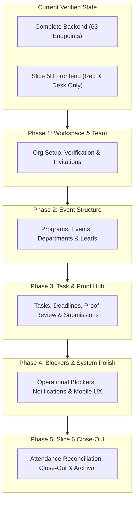
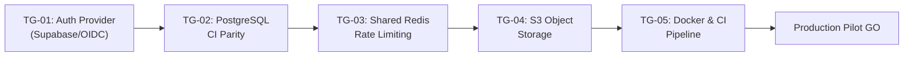

# CampusOps — Next-Phase Implementation Blueprint

**Document version:** 1.0  
**Effective date:** 30 October 2026  
**Status:** Approved Engineering Implementation Blueprint  
**Repository:** `D:\Antigravity_Projects\CampusOps`  
**Reference Document:** `docs/implementation/SYSTEM_INTEGRATION_READINESS_AUDIT.md`

---

## 1. Overview & Strategic Goals

The System-Wide Integration Readiness Audit revealed a critical architectural reality:
- **Backend Foundation is Mature & Comprehensive:** 63 REST API endpoints, 12 normalized database models, robust composite foreign keys, and 305 passing backend tests covering workspace management, program/event hierarchies, tasks, proof reviews, blockers, notifications, registration, and attendance check-in.
- **Frontend Integration is Asymmetric:** While Slice 5D successfully delivered a high-velocity, accessible, and visually distinctive frontend for participant registration and event-day check-in (Capabilities 10–15), **Capabilities 1 through 9 remain entirely without frontend user interfaces**.

Attempting to implement Slice 6 (Post-Event Operations) before building interfaces for event creation, department setup, task assignment, and proof review would widen the gap between backend capabilities and user-facing workflows.

**Strategic Objective:** Execute a disciplined, five-phase implementation plan that connects the React 19 frontend to the existing Slice 2B, 3B, and 4B backend APIs, repairs minor responsive mobile layout issues, validates the QR generation engine against an automated decoder, and then seamlessly transitions to Slice 6 (Post-Event Operations).

---

## 2. Architectural Principles & Implementation Rules

Every phase in this blueprint must adhere strictly to the foundational project rules:

1. **Modular Monolith & Fail-Closed Authentication:**
   - Preserve `app.api.v1` modular routing and deny-by-default permission checks.
   - All staff routes require authenticated sessions; unauthenticated states fail closed with clear user guidance.
   - Strictly avoid mock logins, hardcoded bypass tokens, or fake success states in production code.

2. **Strict Server-Side Enforcement:**
   - Client-side validation is solely for immediate user feedback; all authorization, tenant scoping, and state transitions are enforced server-side.
   - Cross-tenant requests return uniform `HTTP 404` responses to prevent entity enumeration.

3. **Accessibility, Tokens & Ergonomics:**
   - Reuse established design tokens (`theme.css`) and component patterns (`components.css`, `Dialog.tsx`, `Toast.tsx`, `Icons.tsx`).
   - All interactive dialogs must implement focus trapping, `Escape` key close, and focus restoration to opener elements.
   - Screen-reader announcements and keyboard navigation must be supported for all data tables and forms.

4. **Preservation of Existing Test Baselines:**
   - Maintain 305 backend pytest tests and 30 frontend Vitest tests. Every phase must add automated unit and integration tests verifying new components and API clients.

---

## 3. Prioritized Phased Implementation Roadmap

---

### Phase 1: Workspace, Organization & Team Management Frontend

#### 1. Objective
Enable institution organizers and platform operators to create workspaces, view organization verification status, send scoped email invitations, accept invitations securely via token body, and view member directories.

#### 2. User Workflows
- **Organizer Workspace Creation:** User navigates to organization setup, enters name and slug, and creates an organization. Workspace enters `pending_verification` status; user is granted `PRIMARY_ADMIN`.
- **Platform Operator Verification Queue:** Platform admins review pending organizations with notes and approve/reject them.
- **Member Invitation Journey:** Primary admins and office bearers invite members by email with specified roles (`OFFICE_BEARER`, `COORDINATOR`, `MEMBER`).
- **Invitation Acceptance Journey:** Public user receives email link, navigates to `/invitations/accept?token=...`, reviews invitation details, and accepts via JSON POST body (preventing token leakage).

#### 3. Existing Backend Dependencies
- `POST /api/v1/organizations`
- `GET /api/v1/organizations`
- `GET /api/v1/organizations/{id}`
- `POST /api/v1/organizations/{id}/verify`
- `POST /api/v1/organizations/{id}/invitations`
- `POST /api/v1/invitations/accept`
- `POST /api/v1/organizations/{id}/invitations/{id}/revoke`
- `GET /api/v1/me`

#### 4. Required Frontend Pages & Components
- `frontend/src/api/organizations.ts`: API client functions for organizations and invitations.
- `frontend/src/components/org/OrganizationSwitcher.tsx`: Dropdown for switching active organization workspaces.
- `frontend/src/components/org/CreateOrgModal.tsx`: Form to establish a new organization workspace.
- `frontend/src/components/org/VerificationBanner.tsx`: Informative warning for `pending_verification` status.
- `frontend/src/components/org/InviteMemberModal.tsx`: Scoped invitation modal with email and role picker.
- `frontend/src/components/org/InvitationAcceptView.tsx`: Public acceptance screen with token handling.
- `frontend/src/components/org/MemberDirectoryTable.tsx`: List of active organization members and assigned roles.

#### 5. Security Considerations
- Invitations accept raw token via POST body only; tokens are never logged or stored in browser storage.
- Verification notes are visible only to admins; reviewer identity is censored for non-platform admins.
- Uniform HTTP 404 for non-member access to organization endpoints.

#### 6. Acceptance Criteria
- Workspace creation successfully creates a pending organization and sets active workspace context.
- Sending an invitation generates an invitation record; email failure produces clear HTTP 503 notification.
- Accepting an invitation atomically transitions user membership and assigns initial roles.

#### 7. Automated Test Requirements
- Vitest tests for `OrganizationSwitcher`, `CreateOrgModal`, and `InvitationAcceptView`.
- Minimum 8 new frontend tests verifying form validation, API error handling, and state synchronization.

---

### Phase 2: Program, Event & Department Structure Frontend

#### 1. Objective
Provide complete user interfaces for the dual setup journeys (Standalone Event Workflow A vs Multi-Event Program Workflow B), event scheduling with timezone support, exclusive department parenting, and event lead delegation.

#### 2. User Workflows
- **Standalone Event Setup (Workflow A):** Organizer creates an event without a program (`program_id IS NULL`), configures dates, times, and IANA timezone, and creates event-specific departments.
- **Multi-Event Program Setup (Workflow B):** Organizer creates an umbrella program (e.g. "TechFest 2026"), defines shared program departments, creates child events under the program, and delegates event leads.
- **Event Lead Delegation:** Organizer assigns active members as `EVENT_LEAD` for specific events with transactional synchronization.

#### 3. Existing Backend Dependencies
- `POST /api/v1/organizations/{id}/programs`
- `GET /api/v1/organizations/{id}/programs`
- `GET /api/v1/organizations/{id}/programs/{id}`
- `PATCH .../programs/{id}`
- `POST .../programs/{id}/archive`
- `GET .../programs/{id}/events`
- `POST .../programs/{id}/events`
- `POST /api/v1/organizations/{id}/events`
- `GET /api/v1/organizations/{id}/events`
- `GET /api/v1/organizations/{id}/events/{id}`
- `PATCH .../events/{id}`
- `POST .../events/{id}/archive`
- `POST /api/v1/organizations/{id}/departments`
- `GET .../departments`
- `PATCH .../departments/{id}`
- `POST .../departments/{id}/archive`
- `POST .../events/{id}/leads`
- `GET .../events/{id}/leads`
- `POST .../events/{id}/leads/{id}/revoke`

#### 4. Required Frontend Pages & Components
- `frontend/src/api/events.ts`: API client functions for programs, events, departments, and leads.
- `frontend/src/components/events/ProgramListCard.tsx`: Grid/list of active programs with date ranges and child event counts.
- `frontend/src/components/events/CreateProgramModal.tsx`: Form for umbrella programs (dates, description).
- `frontend/src/components/events/EventFormModal.tsx`: Shared event modal supporting standalone or child event creation with date/time pickers and IANA timezone selector.
- `frontend/src/components/events/DepartmentManager.tsx`: Drawer to add, edit, and archive departments enforcing program XOR event scoping.
- `frontend/src/components/events/EventLeadAssignmentModal.tsx`: Searchable member picker to delegate event leads.

#### 5. Security Considerations
- Client-side validation of temporal order (`event_end_date >= event_date`, `end_time >= start_time`).
- Enforce check constraint `ck_departments_exclusive_parent` via strict modal mode selection (Program vs Event).
- Archived parents prevent creation of child events or departments.

#### 6. Acceptance Criteria
- User can create both standalone events and child events under programs.
- Multi-day events cleanly validate dates and times.
- Event leads can be assigned and revoked with immediate UI synchronization.

#### 7. Automated Test Requirements
- Vitest tests covering `EventFormModal` date bounds validation, timezone selection, and department exclusivity logic.
- Minimum 10 new frontend tests.

---

### Phase 3: Task Management, Proof Review & Operational Deadlines Frontend

#### 1. Objective
Deliver the task coordination hub: task creation across scopes, strict single-active-worker assignment, audited deadline extensions, link/file evidence submission, and manager proof review enforcing the strict **No-Self-Review Rule**.

#### 2. User Workflows
- **Task Creation:** Department lead or event manager creates a task with title, description, priority, mandatory deadline, and scope (Org, Program, Event, Department).
- **Single-Worker Assignment:** Manager assigns an active organization member. Assignee receives immediate task view and submission authority.
- **Deadline Extension Audit:** Manager changes a deadline, entering a non-empty mandatory justification. Audit history updates immediately.
- **Evidence Submission:** Assignee starts task, completes work, and submits evidence URL link. Task transitions to `Submitted for Review`.
- **Proof Review Workflow:** Manager reviews submission. If the reviewer is the submitter or active assignee, review actions are disabled (enforcing No-Self-Review). Reviewer either approves (task marked `completed`) or requests changes with mandatory feedback (task marked `in_progress`).

#### 3. Existing Backend Dependencies
- `POST /api/v1/organizations/{id}/tasks`
- `GET /api/v1/organizations/{id}/tasks`
- `GET /api/v1/organizations/{id}/tasks/{id}`
- `PATCH .../tasks/{id}`
- `POST .../tasks/{id}/assign`
- `POST .../tasks/{id}/start`
- `POST .../tasks/{id}/deadline`
- `GET .../tasks/{id}/history`
- `POST .../tasks/{id}/submissions`
- `GET .../tasks/{id}/submissions`
- `POST .../tasks/{id}/submissions/{id}/review`
- `POST .../tasks/{id}/cancel`

#### 4. Required Frontend Pages & Components
- `frontend/src/api/tasks.ts`: API client functions for tasks, assignments, deadlines, and submissions.
- `frontend/src/components/tasks/TaskBoard.tsx`: Tabular and Kanban task view filtered by event, department, status, and assignee.
- `frontend/src/components/tasks/CreateTaskModal.tsx`: Form for task creation with deadline and scope selectors.
- `frontend/src/components/tasks/TaskDetailDrawer.tsx`: Full slide-over drawer showing task status, active assignee, deadline countdown, and history timeline.
- `frontend/src/components/tasks/DeadlineChangeModal.tsx`: Dialog requiring new due date/time and mandatory reason ($\ge 5$ chars).
- `frontend/src/components/tasks/EvidenceSubmissionModal.tsx`: Submitter form accepting valid HTTP/HTTPS evidence URL with description.
- `frontend/src/components/tasks/ProofReviewModal.tsx`: Manager review interface with disabled state and tooltip when reviewer is the submitter.

#### 5. Security Considerations
- Strict enforcement of **No-Self-Review Rule**: Submitter ID and current caller ID are compared; approve/reject actions are disabled client-side and rejected with `HTTP 400` server-side.
- Evidence URLs strictly validated (max 2048 chars, HTTP/HTTPS scheme, zero server fetch).
- Deadlines require non-empty reasons and record full audit entries in `TaskDeadlineHistory`.

#### 6. Acceptance Criteria
- Assigning a member auto-unassigns any prior worker and reflects in the task history.
- Evidence submission triggers `Submitted for Review` status and notifies leads.
- Submitter cannot approve their own submission under any circumstances.
- Deadline changes append immutable history entries.

#### 7. Automated Test Requirements
- Vitest tests for `TaskBoard`, `ProofReviewModal` (testing self-review blocking), and `DeadlineChangeModal`.
- Minimum 12 new frontend tests.

---

### Phase 4: Event-Day Coordination, Blockers & System Polish

#### 1. Objective
Implement the event-day operational blocker board, in-app notification center, mobile navigation responsive fix, and automated QR decoder validation.

#### 2. User Workflows
- **Staff Blocker Board:** Ground staff report an operational blocker (e.g. "Audio system power failure in Auditorium B"). Event leads receive alerts, reassign resources, resolve with notes, or reopen if recurred.
- **In-App Notification Center:** Users click the notification bell in the navbar to view task assignments, review feedback, and blocker alerts; mark individual or all items as read.
- **Mobile Responsive Operations:** Check-in staff and volunteers operate seamlessly on mobile devices ($375\text{px}$) with zero horizontal scrolling or layout breakage.

#### 3. Existing Backend Dependencies
- `POST /api/v1/organizations/{id}/blockers`
- `GET /api/v1/organizations/{id}/blockers`
- `GET .../blockers/{id}`
- `PATCH .../blockers/{id}`
- `POST .../blockers/{id}/resolve`
- `POST .../blockers/{id}/reopen`
- `GET /api/v1/notifications`
- `GET .../notifications/{id}`
- `POST .../notifications/{id}/read`

#### 4. Required Frontend Pages & Components
- `frontend/src/api/blockers.ts`: API client functions for blockers and notifications.
- `frontend/src/components/blockers/BlockerBoard.tsx`: Live feed of open, resolved, and wont-fix blockers with severity badges.
- `frontend/src/components/blockers/ReportBlockerModal.tsx`: Quick-entry form for ground staff.
- `frontend/src/components/blockers/ResolveBlockerModal.tsx`: Resolution dialog requiring non-empty resolution notes.
- `frontend/src/components/layout/NotificationCenter.tsx`: Flyout drawer with unread counter badge.
- `frontend/src/components/layout/Navbar.tsx` (Remediation): Responsive media query restructuring for viewports $\le 640\text{px}$.
- `frontend/src/test/qr_decoder.test.ts`: Integration test verifying that generated QR SVGs are independently decodable by a standard decoder algorithm.

#### 5. Security Considerations
- Blockers are strictly internal to staff; participants have zero access to blocker routes or telemetry.
- Resolving a blocker requires mandatory notes; reopening requires resolved status.

#### 6. Acceptance Criteria
- Blocker status changes update immediately without full-page reloads.
- Navbar renders cleanly on $375\text{px}$ viewports with zero horizontal overflow.
- Automated tests prove that `generateQrSvg` produces scannable, standards-compliant QR codes decodable back to raw tokens.

#### 7. Automated Test Requirements
- Vitest tests for `BlockerBoard`, `NotificationCenter`, and QR decoder roundtrip validation.
- Minimum 8 new frontend tests.

---

### Phase 5: Slice 6 — Post-Event Operations & Close-Out Architecture

#### 1. Objective
Design and implement post-event reconciliation, close-out checklists, attendance-versus-registration rollups, photo/report evidence archiving, and program-level aggregated reporting.

#### 2. Key Capabilities in Scope
1. **Attendance Reconciliation Rollup:**
   - Automated reconciliation comparing total registrations, confirmed tickets, actual check-ins, walk-ins, and voids.
   - Discrepancy analysis identifying no-shows and capacity utilization rates.
2. **Event Close-Out Checklist:**
   - Formal stage gate transitioning event status from `completed` to `closed`.
   - Verification that all tasks are in terminal states (`completed` or `cancelled`) and all operational blockers are resolved.
3. **Post-Event Evidence & Photo Reports:**
   - Structured submission of final event reports, sponsor compliance photos, and summary documentation.
4. **Program-Level Aggregation:**
   - Rollup metrics across multi-event programs (total unique attendees, departmental task completion ratios, cross-event attendance).

#### 3. Prerequisites & Entry Criteria
- Phase 1 through Phase 4 frontend integrations complete and verified.
- Alembic migration `d9e0f1a2b3c4_slice_6_post_event_operations.py` designed and verified.
- Pydantic v2 schemas and domain services implemented following established security patterns.

---

## 4. Production Readiness Milestones & Governance Gates

Before declaring CampusOps ready for a production pilot, the following technical gates must be cleared:

1. **Gate TG-01 (Authentication Integration):** Replace the fail-closed auth stub with live hosted identity provider verification (Supabase Auth / OIDC), validating RS256 JWT signatures against JWKS with caching and key rotation.
2. **Gate TG-02 (PostgreSQL Parity):** Execute Alembic migrations and automated test suites against a live PostgreSQL 16+ engine in continuous integration.
3. **Gate TG-03 (Distributed Rate Limiting):** Deploy shared Redis sliding-window rate limiting on public registration and check-in endpoints.
4. **Gate TG-04 (Private Object Storage):** Implement pre-signed S3/GCS upload URLs with server-side virus scanning and mime-type enforcement for task evidence.
5. **Gate TG-05 (Production Containerization):** Provide multi-stage Dockerfiles and GitHub Actions workflow executing full-stack build and test suites on pull requests.

---

## 5. Verification & Exit Criteria

Each phase of this blueprint concludes with an authoritative verification checkpoint:
- Full backend pytest suite maintains 100% pass rate (305+ tests).
- Frontend Vitest suite expands to $\ge 75$ tests covering all newly created views.
- Frontend production build (`tsc -b && vite build`) completes with zero TypeScript or packaging errors.
- Visual inspection via headless browser verifies responsive behavior at 1280px, 768px, and 375px.
- Status and governance records in `IMPLEMENTATION_STATUS.md` updated with verified facts only.

