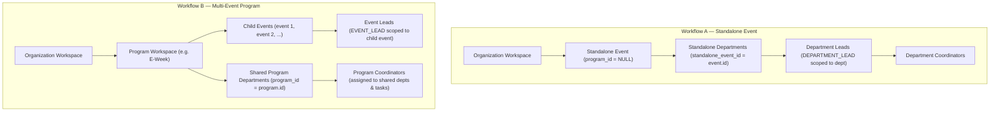

# CampusOps — Slice 3 Design Plan: Programs, Events, Departments & Event Leads

**Document Version:** 1.0
**Status:** Architecture and Implementation Plan for Slice 3 (Design Only — Zero Code Implemented)
**Authoritative References:**
- `Consolidated Documentation/CampusOps_PRD_v1.1.md` (§5, §6)
- `Consolidated Documentation/CampusOps_Technical_Specification_v1.1.md` (§4, §5)
- `Consolidated Documentation/CampusOps_Data_Model_and_Relationship_Map_v0.1.md` (§5, §6)
- `Consolidated Documentation/CampusOps_Role_and_Permission_Matrix_v0.1.md` (§3, §4, §5, §6)
- `Consolidated Documentation/CampusOps_API_Contract_Draft_v0.2.md`
- `Consolidated Documentation/CampusOps_Decision_Log_v1.4.md` (FPC-01, FPC-02, FPC-03)

---

## 1. Overview & Scope Boundaries

Development Slice 3 establishes the event operational foundation for CampusOps. It introduces domain models, relational database schemas, Alembic migrations, authorization engines, and REST endpoints for:
1. **Programs:** Parent multi-event structures (e.g. E-Week).
2. **Events:** Operational event instances, supporting both standalone events and child events within a program.
3. **Departments:** Functional teams (e.g. Sponsorship, Logistics, Design), supporting standalone event scoping and shared program scoping.
4. **Event Leads:** Explicit assignment of members leading specific events within a multi-event program.
5. **Scoped Invitations:** Unblocking `department` and `event` scope assignments in the invitation engine with database-backed scope validation.

### Strict Non-Goals for Slice 3
- Tasks, task dependencies, evidence submission, and task reviews (Deferred to Slice 4).
- Participant registrations, registration forms, and external imports (Deferred to Slice 5).
- QR code scanning and event-day check-in (Deferred to Slice 6).
- Post-event report compilation and analytics (Deferred to Slice 7).

---

## 2. Dual Setup Workflows: Standalone Events vs. Multi-Event Programs

Per PRD v1.1 §5 and Role & Permission Matrix v0.1 §5–6, CampusOps supports two distinct setup journeys:



### 2.1 Workflow Comparison Table

| Attribute | Standalone Event (Workflow A) | Multi-Event Program (Workflow B) |
| :--- | :--- | :--- |
| **Parent Entity** | Organization only (`program_id IS NULL`) | `Program` (`program_id = program.id`) |
| **Department Ownership** | Owned by the specific event (`standalone_event_id = event.id`) | Owned by the parent program (`program_id = program.id`) and shared across child events |
| **Department Leadership** | Has dedicated `DEPARTMENT_LEAD` per department | No separate department leads by default; shared teams work across child events |
| **Event Leadership** | Primary Administrator or Office Bearer oversees the event | Explicit `EVENT_LEAD` assigned per child event |
| **Coordinator Assignment**| Assigned to the standalone department | Assigned to shared program departments and assigned to specific child-event tasks |
| **Reporting / Summary** | Single event-level dashboard | Program-level aggregated overview without merging underlying child event data |

---

## 3. Relational Schema & Invariant Architecture

### 3.1 `programs` Table
Represents a multi-event program umbrella within an organization.
```sql
CREATE TABLE programs (
    id CHAR(36) PRIMARY KEY,                             -- UUID PK
    organization_id CHAR(36) NOT NULL,                   -- FK to organizations.id
    name VARCHAR(150) NOT NULL,
    description TEXT,
    planned_start_date DATE,
    planned_end_date DATE,
    status VARCHAR(30) NOT NULL DEFAULT 'draft',         -- 'draft', 'active', 'completed', 'archived'
    created_by_user_id CHAR(36) NOT NULL,                -- FK to user_profiles.id
    created_at TIMESTAMP WITH TIME ZONE NOT NULL,
    updated_at TIMESTAMP WITH TIME ZONE NOT NULL,
    archived_at TIMESTAMP WITH TIME ZONE,
    CONSTRAINT fk_programs_organization FOREIGN KEY (organization_id)
        REFERENCES organizations (id) ON DELETE CASCADE,
    CONSTRAINT fk_programs_creator FOREIGN KEY (created_by_user_id)
        REFERENCES user_profiles (id) ON DELETE RESTRICT,
    CONSTRAINT uq_programs_org_name UNIQUE (organization_id, name)
);
CREATE INDEX ix_programs_org_status ON programs (organization_id, status);
```

### 3.2 `events` Table
Represents an individual event. Can be standalone (`program_id IS NULL`) or child (`program_id IS NOT NULL`).
```sql
CREATE TABLE events (
    id CHAR(36) PRIMARY KEY,                             -- UUID PK
    organization_id CHAR(36) NOT NULL,                   -- FK to organizations.id
    program_id CHAR(36),                                 -- FK to programs.id (NULL if standalone)
    name VARCHAR(150) NOT NULL,
    description TEXT,
    event_date DATE,
    planned_start_time TIMESTAMP WITH TIME ZONE,
    planned_end_time TIMESTAMP WITH TIME ZONE,
    venue VARCHAR(200),
    event_format VARCHAR(50) NOT NULL DEFAULT 'in_person', -- 'in_person', 'virtual', 'hybrid'
    registration_mode VARCHAR(50) NOT NULL DEFAULT 'individual', -- 'individual', 'team'
    status VARCHAR(30) NOT NULL DEFAULT 'draft',         -- 'draft', 'published', 'completed', 'cancelled'
    created_by_user_id CHAR(36) NOT NULL,                -- FK to user_profiles.id
    created_at TIMESTAMP WITH TIME ZONE NOT NULL,
    updated_at TIMESTAMP WITH TIME ZONE NOT NULL,
    archived_at TIMESTAMP WITH TIME ZONE,
    CONSTRAINT fk_events_organization FOREIGN KEY (organization_id)
        REFERENCES organizations (id) ON DELETE CASCADE,
    CONSTRAINT fk_events_program FOREIGN KEY (program_id)
        REFERENCES programs (id) ON DELETE CASCADE,
    CONSTRAINT fk_events_creator FOREIGN KEY (created_by_user_id)
        REFERENCES user_profiles (id) ON DELETE RESTRICT
);
CREATE INDEX ix_events_org_program ON events (organization_id, program_id);
CREATE INDEX ix_events_date ON events (organization_id, event_date);
```

### 3.3 `departments` Table
Represents a functional department. Enforces the **exclusive parent constraint**: a department must belong either to a Program OR to a Standalone Event, never both and never neither.
```sql
CREATE TABLE departments (
    id CHAR(36) PRIMARY KEY,                             -- UUID PK
    organization_id CHAR(36) NOT NULL,                   -- FK to organizations.id
    name VARCHAR(100) NOT NULL,
    description TEXT,
    program_id CHAR(36),                                 -- FK to programs.id (if shared program dept)
    standalone_event_id CHAR(36),                        -- FK to events.id (if standalone event dept)
    status VARCHAR(30) NOT NULL DEFAULT 'active',        -- 'active', 'archived'
    created_by_user_id CHAR(36) NOT NULL,                -- FK to user_profiles.id
    created_at TIMESTAMP WITH TIME ZONE NOT NULL,
    updated_at TIMESTAMP WITH TIME ZONE NOT NULL,
    archived_at TIMESTAMP WITH TIME ZONE,
    CONSTRAINT fk_departments_organization FOREIGN KEY (organization_id)
        REFERENCES organizations (id) ON DELETE CASCADE,
    CONSTRAINT fk_departments_program FOREIGN KEY (program_id)
        REFERENCES programs (id) ON DELETE CASCADE,
    CONSTRAINT fk_departments_standalone_event FOREIGN KEY (standalone_event_id)
        REFERENCES events (id) ON DELETE CASCADE,
    CONSTRAINT fk_departments_creator FOREIGN KEY (created_by_user_id)
        REFERENCES user_profiles (id) ON DELETE RESTRICT,
    -- Exclusive Scope Invariant: exactly one parent foreign key must be non-null
    CONSTRAINT ck_departments_exclusive_parent CHECK (
        (program_id IS NOT NULL AND standalone_event_id IS NULL) OR
        (program_id IS NULL AND standalone_event_id IS NOT NULL)
    )
);
CREATE INDEX ix_departments_org_program ON departments (organization_id, program_id);
CREATE INDEX ix_departments_org_event ON departments (organization_id, standalone_event_id);
```

### 3.4 `event_lead_assignments` Table
Maps an active workspace member to an assigned child event as an Event Lead in a multi-event program.
```sql
CREATE TABLE event_lead_assignments (
    id CHAR(36) PRIMARY KEY,                             -- UUID PK
    organization_id CHAR(36) NOT NULL,                   -- FK to organizations.id
    event_id CHAR(36) NOT NULL,                          -- FK to events.id
    membership_id CHAR(36) NOT NULL,                     -- FK to organization_memberships.id
    assigned_by_user_id CHAR(36) NOT NULL,               -- FK to user_profiles.id
    assigned_at TIMESTAMP WITH TIME ZONE NOT NULL,
    revoked_at TIMESTAMP WITH TIME ZONE,
    CONSTRAINT fk_event_leads_organization FOREIGN KEY (organization_id)
        REFERENCES organizations (id) ON DELETE CASCADE,
    CONSTRAINT fk_event_leads_event FOREIGN KEY (event_id)
        REFERENCES events (id) ON DELETE CASCADE,
    CONSTRAINT fk_event_leads_membership FOREIGN KEY (membership_id)
        REFERENCES organization_memberships (id) ON DELETE CASCADE,
    CONSTRAINT fk_event_leads_assigner FOREIGN KEY (assigned_by_user_id)
        REFERENCES user_profiles (id) ON DELETE RESTRICT,
    -- Prevent duplicate active assignment of the same member to the same event
    CONSTRAINT uq_event_lead_active UNIQUE (event_id, membership_id, revoked_at)
);
CREATE INDEX ix_event_leads_event ON event_lead_assignments (event_id, membership_id);
```

---

## 4. Tenant Boundary & Resource Scope Validation

In Slice 2A, [`validate_target_resource_scope`](file:///D:/Antigravity_Projects/CampusOps/backend/app/services/permissions.py#L40-L60) deferred entity validation because child tables did not exist. In Slice 3, this function must be upgraded to perform strict relational tenant validation:

```python
def validate_target_resource_scope(
    db: Session,
    organization_id: uuid.UUID,
    scope_type: str,
    scope_id: Optional[uuid.UUID],
) -> bool:
    """
    Validates that the target resource exists, is active, and is owned by the organization.
    Prevents cross-tenant entity linkage and alien resource access.
    """
    if scope_type == "organization":
        return scope_id is None or scope_id == organization_id

    if scope_id is None:
        return False

    if scope_type == "event":
        event = db.get(Event, scope_id)
        if not event or event.archived_at is not None:
            return False
        return event.organization_id == organization_id

    if scope_type == "department":
        dept = db.get(Department, scope_id)
        if not dept or dept.archived_at is not None:
            return False
        return dept.organization_id == organization_id

    if scope_type == "program":
        program = db.get(Program, scope_id)
        if not program or program.archived_at is not None:
            return False
        return program.organization_id == organization_id

    return False
```

### 4.1 Cross-Tenant Foreign Key Prevention in Service Layer
When creating child entities:
- `create_event(..., program_id=...)`: If `program_id` is passed, the service queries `Program` where `id == program_id`. If `program.organization_id != target_organization_id`, reject with `HTTP 400 Bad Request` (`"Program does not belong to this organization"`).
- `create_department(..., standalone_event_id=..., program_id=...)`: The service validates that the referenced parent event or program belongs to `organization_id`. Furthermore, if `standalone_event_id` is supplied, the service confirms `event.program_id IS NULL` (cannot attach a standalone department to a child event).

---

## 5. Permission & Access Control Matrix for Slice 3

| Role Name | Scope | Can Create Programs? | Can Create Events? | Can Edit Event Details? | Can Create Departments? | Can Assign Event Leads? | Can Invite Members? |
| :--- | :--- | :--- | :--- | :--- | :--- | :--- | :--- |
| **PRIMARY_ADMIN** | Organization | Yes (if org verified) | Yes (if org verified) | Yes (all events in org) | Yes (all depts in org) | Yes | Yes (all roles & scopes) |
| **OFFICE_BEARER** | Organization | Yes (if org verified) | Yes (if org verified) | Yes (all events in org) | Yes (all depts in org) | Yes | Yes (event/dept scopes) |
| **EVENT_LEAD** | Event (`scope_id=event.id`) | No | No | Yes (assigned event only) | No (uses shared depts) | No | Scoped to assigned event (if granted) |
| **DEPARTMENT_LEAD** | Dept (`scope_id=dept.id`) | No | No | No | No | No | Scoped to own dept (Standalone only) |
| **COORDINATOR** | Dept/Event/Task | No | No | No | No | No | No |

*Note: Per FPC-02 and FPC-03, privileged actions (event creation, program creation, role management, and invitation dispatch) are blocked while the organization is in `pending_verification` status.*

---

## 6. Alembic Migration & Rollback Specification

### 6.1 Revision Metadata
- **Migration ID:** `c92f1b4a3d10`
- **Down Revision:** `880d8e4eb890` (Slice 2A migration)
- **Description:** `slice_3_programs_events_departments_and_event_leads`
- **Batch Mode:** Mandatory `render_as_batch=True` enabled for SQLite compatibility.

### 6.2 Upgrade Execution Order
1. Create `programs` table (foreign key to `organizations`, `user_profiles`).
2. Create `events` table (foreign key to `organizations`, `programs`, `user_profiles`).
3. Create `departments` table (foreign key to `organizations`, `programs`, `events`, `user_profiles`; check constraint `ck_departments_exclusive_parent`).
4. Create `event_lead_assignments` table (foreign key to `organizations`, `events`, `organization_memberships`, `user_profiles`).

### 6.3 Downgrade Execution Order
1. Drop `event_lead_assignments` table.
2. Drop `departments` table.
3. Drop `events` table.
4. Drop `programs` table.

---

## 7. REST API Extensions & Contract Specification

All request payloads enforce Pydantic v2 `extra="forbid"`. All responses return explicit, non-leaking schemas.

### 7.1 Program Endpoints
- `POST /api/v1/organizations/{org_id}/programs`: Create a multi-event program.
  - Requires `PRIMARY_ADMIN` or `OFFICE_BEARER`. Requires verified organization.
  - Request: `{"name": "E-Week 2027", "description": "...", "planned_start_date": "2027-02-10", "planned_end_date": "2027-02-15"}`
  - Response: `ProgramResponse` (`HTTP 201 Created`).
- `GET /api/v1/organizations/{org_id}/programs`: List programs for organization members.
  - Returns `List[ProgramResponse]`.
- `GET /api/v1/organizations/{org_id}/programs/{program_id}`: Program details with child event summary.

### 7.2 Event Endpoints
- `POST /api/v1/organizations/{org_id}/events`: Create an event.
  - If `program_id` is null -> creates Standalone Event.
  - If `program_id` is provided -> validates program exists and belongs to `org_id`, creates Child Event.
  - Request: `{"name": "Hackathon", "program_id": null, "event_date": "2027-02-12", "venue": "Auditorium", "registration_mode": "team"}`
  - Response: `EventResponse` (`HTTP 201 Created`).
- `GET /api/v1/organizations/{org_id}/events`: List events. Filterable by `program_id`.
- `GET /api/v1/organizations/{org_id}/events/{event_id}`: Event details. Unauthorized non-members receive HTTP 404.
- `PATCH /api/v1/organizations/{org_id}/events/{event_id}`: Update event details (schedule, venue, format).
  - Allowed for `PRIMARY_ADMIN`, `OFFICE_BEARER`, or assigned `EVENT_LEAD`.

### 7.3 Department Endpoints
- `POST /api/v1/organizations/{org_id}/departments`: Create a department.
  - Enforces exclusive parent: either `program_id` XOR `standalone_event_id`.
  - Request: `{"name": "Logistics", "program_id": "<uuid>", "standalone_event_id": null}`
  - Response: `DepartmentResponse` (`HTTP 201 Created`).
- `GET /api/v1/organizations/{org_id}/departments`: List departments. Filterable by `program_id` or `standalone_event_id`.

### 7.4 Event Lead Assignment Endpoints
- `POST /api/v1/organizations/{org_id}/events/{event_id}/leads`: Assign an event lead.
  - Requires `PRIMARY_ADMIN` or `OFFICE_BEARER`.
  - Creates both `EventLeadAssignment` record and `RoleAssignment(role_name="EVENT_LEAD", scope_type="event", scope_id=event.id)`.
  - Request: `{"membership_id": "<uuid>"}`
  - Response: `EventLeadResponse` (`HTTP 201 Created`).
- `DELETE /api/v1/organizations/{org_id}/events/{event_id}/leads/{assignment_id}`: Revoke event lead assignment.

### 7.5 Unblocking Scoped Invitations
- Update `POST /api/v1/organizations/{org_id}/invitations`:
  - When `scope_type == "department"`: Verify `Department` exists in `org_id`, allow `DEPARTMENT_LEAD` or `COORDINATOR`.
  - When `scope_type == "event"`: Verify `Event` exists in `org_id`, allow `EVENT_LEAD` or `REGISTRATION_STAFF`.

---

## 8. Comprehensive Acceptance Test Plan

The Slice 3 test suite will implement tests across four categories:

### 8.1 Positive Functional Tests
1. **Standalone Event Lifecycle:**
   - Create organization -> verify organization -> create standalone event (`program_id=None`) -> create standalone departments -> invite and assign `DEPARTMENT_LEAD` -> invite `COORDINATOR`.
2. **Multi-Event Program Lifecycle:**
   - Create organization -> verify organization -> create program -> create shared departments -> create 3 child events under program -> assign `EVENT_LEAD` to child event 1 -> assign different `EVENT_LEAD` to child event 2.

### 8.2 Negative Integrity & Constraint Tests
3. **Cross-Tenant Program/Event Linkage Rejection:**
   - Attempt to create an Event in Org A referencing a Program in Org B -> rejected with HTTP 400.
4. **Exclusive Scope Violation Rejection:**
   - Attempt to create a Department with both `program_id` and `standalone_event_id` populated -> rejected by DB check constraint and Pydantic validator.
   - Attempt to create a Department with neither populated -> rejected.
5. **Standalone Department on Child Event Rejection:**
   - Attempt to create a department with `standalone_event_id` pointing to an event that has `program_id IS NOT NULL` -> rejected with HTTP 400.
6. **Duplicate Event Lead Prevention:**
   - Attempt to assign the same member as active `EVENT_LEAD` twice to the same event -> rejected with HTTP 409 Conflict.

### 8.3 Authorization & Tenant Isolation Tests
7. **Unverified Organization Restriction:**
   - Attempt to create an Event or Program while organization is `pending_verification` -> rejected with HTTP 403 Forbidden per FPC-02.
8. **Event Lead Scope Isolation:**
   - Verify that an `EVENT_LEAD` on Event 1 can edit Event 1, but receives HTTP 404/403 when attempting to edit Event 2.
9. **Department Lead Scope Isolation:**
   - Verify that a `DEPARTMENT_LEAD` in Standalone Department 1 cannot assign coordinators to Standalone Department 2.
10. **Foreign Member Access Rejection:**
    - Verify that members of Org B calling `GET /organizations/{org_A}/events` receive HTTP 404 Not Found.

### 8.4 SQLite vs. PostgreSQL Verification
- **SQLite Dev/Test Limitations:** SQLite in file mode serializes write operations and does not support true concurrent transactions or partial unique index clauses in older engine versions.
- **PostgreSQL Requirement:** When executing technical gate verification on PostgreSQL (TG-03/TG-07), composite foreign keys, partial unique indexes (`WHERE revoked_at IS NULL`), and transaction isolation levels must be verified.

---

## 9. Unresolved Product Policy Questions for Founder Review

The following questions are identified from the consolidated documentation as open policy choices that must be reviewed before final behavioral freeze:

1. **Child Event Specific Departments in Programs:**
   - *Question:* Can a child event in a multi-event program create its own event-specific department (e.g. "Stage Setup for Hackathon") in addition to using the program's shared departments?
   - *Current Plan Assumption:* Multi-event programs use shared departments exclusively. Event-specific departments are restricted to standalone events unless explicitly authorized.
2. **Maximum Number of Event Leads:**
   - *Question:* Is an event restricted to exactly one primary Event Lead, or can an event have multiple co-leads?
   - *Current Plan Assumption:* Multiple active event leads are supported via `event_lead_assignments`.
3. **Conversion of Standalone Event to Program:**
   - *Question:* If an event starts as standalone, can organizers later convert it into a child event under a newly created Program?
   - *Current Plan Assumption:* Disallowed in initial release. `program_id` is immutable once set to prevent orphaned departmental hierarchies.
4. **Archival Cascades:**
   - *Question:* When a Program is archived, should all child Events and shared Departments be automatically archived, or can child events remain active independently?
   - *Current Plan Assumption:* Archiving a program soft-deletes (`archived_at = now`) the program and restricts access to child events.
