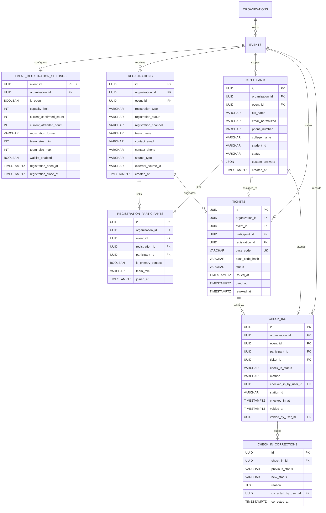

# CampusOps — Slice 5 Relational Schema and Relationship Plan

**Date:** 29 October 2026  
**Status:** Architecture & Design Plan (Slice 5A — Design Only)  
**Authoritative Context:** `Consolidated Documentation/CampusOps_Data_Model_and_Relationship_Map_v0.1.md` Section 8, `CampusOps_Technical_Specification_v1.1.md` Section 3.4, and `Consolidated Documentation/CampusOps_PRD_v1.1.md` (CO-FR-008, CO-FR-009).

---

## 1. Entity-Relationship Overview

Slice 5 establishes a normalized relational schema supporting individual and team registrations, non-payment admission passes, and individual check-ins with audit trails.

---

## 2. Table Specifications & Database Constraints

### 2.1 `event_registration_settings`
Configures registration parameters, capacity limits, and operational counters for an event. Enforces 1-to-1 relationship with `events`.

| Column | Type | Nullable | Default | Description |
| :--- | :--- | :---: | :---: | :--- |
| `event_id` | `UUID` | **NO** | — | **PK**, **FK** -> `events.id` (ON DELETE CASCADE) |
| `organization_id` | `UUID` | **NO** | — | **FK** -> `organizations.id` (ON DELETE CASCADE) |
| `is_open` | `BOOLEAN` | **NO** | `TRUE` | Master kill-switch toggling registration availability |
| `registration_format` | `VARCHAR(30)` | **NO** | `'both'` | Allowed formats: `'solo_only'`, `'team_only'`, `'both'` |
| `capacity_limit` | `INTEGER` | YES | `NULL` | Maximum individual participants allowed; `NULL` = unlimited |
| `current_confirmed_count` | `INTEGER` | **NO** | `0` | Atomic counter tracking total confirmed individual participants |
| `current_attended_count` | `INTEGER` | **NO** | `0` | Atomic counter tracking total checked-in participants |
| `waitlist_enabled` | `BOOLEAN` | **NO** | `FALSE` | Whether waitlisting is allowed when capacity is exhausted |
| `team_size_min` | `INTEGER` | **NO** | `2` | Minimum team member count for team registrations |
| `team_size_max` | `INTEGER` | **NO** | `4` | Maximum team member count for team registrations |
| `registration_open_at` | `TIMESTAMPTZ` | YES | `NULL` | Scheduled opening time in event timezone |
| `registration_close_at`| `TIMESTAMPTZ` | YES | `NULL` | Scheduled cutoff time in event timezone |
| `created_at` | `TIMESTAMPTZ` | **NO** | `utcnow()` | Record creation timestamp |
| `updated_at` | `TIMESTAMPTZ` | **NO** | `utcnow()` | Last mutation timestamp |

#### Table Constraints (`event_registration_settings`):
- `PRIMARY KEY (event_id)`
- `FOREIGN KEY (event_id, organization_id) REFERENCES events(id, organization_id) ON DELETE CASCADE`
- `CHECK (registration_format IN ('solo_only', 'team_only', 'both'))`
- `CHECK (team_size_min >= 1 AND team_size_max >= team_size_min)`
- `CHECK (capacity_limit IS NULL OR capacity_limit >= 0)`
- `CHECK (current_confirmed_count >= 0)`
- `CHECK (current_attended_count >= 0)`
- `CHECK (registration_open_at IS NULL OR registration_close_at IS NULL OR registration_close_at >= registration_open_at)`
- `INDEX ix_event_reg_settings_org (organization_id)`

---

### 2.2 `registrations`
Represents an administrative registration transaction header (either a solo entry or a team entry).

| Column | Type | Nullable | Default | Description |
| :--- | :--- | :---: | :---: | :--- |
| `id` | `UUID` | **NO** | `uuid_generate_v4()` | **PK** |
| `organization_id` | `UUID` | **NO** | — | **FK** -> `organizations.id` (ON DELETE CASCADE) |
| `event_id` | `UUID` | **NO** | — | **FK** -> `events.id` (ON DELETE CASCADE) |
| `registration_type` | `VARCHAR(20)` | **NO** | `'individual'` | `'individual'` or `'team'` |
| `registration_status` | `VARCHAR(30)` | **NO** | `'confirmed'` | `'confirmed'`, `'waitlisted'`, `'cancelled'` |
| `registration_channel` | `VARCHAR(20)`| **NO** | `'native_web'` | `'native_web'`, `'walk_in'`, `'external_import'` |
| `team_name` | `VARCHAR(150)`| YES | `NULL` | Team name (mandatory if `registration_type == 'team'`) |
| `contact_email` | `VARCHAR(255)`| **NO** | — | Primary email of the registrant / team lead |
| `contact_phone` | `VARCHAR(50)` | YES | `NULL` | Primary phone of the registrant / team lead |
| `confirmation_code` | `VARCHAR(32)` | **NO** | — | Alphanumeric confirmation reference for registrant lookup |
| `source_type` | `VARCHAR(30)` | **NO** | `'native'` | `'native'`, `'google_forms'`, `'csv'` |
| `external_source_id`| `VARCHAR(255)`| YES | `NULL` | Upstream row/response ID for external imports |
| `cancelled_at` | `TIMESTAMPTZ` | YES | `NULL` | Cancellation timestamp |
| `cancellation_reason`| `TEXT` | YES | `NULL` | Audit reason if cancelled |
| `created_at` | `TIMESTAMPTZ` | **NO** | `utcnow()` | Record submission timestamp |
| `updated_at` | `TIMESTAMPTZ` | **NO** | `utcnow()` | Last mutation timestamp |

#### Table Constraints (`registrations`):
- `PRIMARY KEY (id)`
- `FOREIGN KEY (event_id, organization_id) REFERENCES events(id, organization_id) ON DELETE CASCADE`
- `CHECK (registration_type IN ('individual', 'team'))`
- `CHECK (registration_status IN ('confirmed', 'waitlisted', 'cancelled'))`
- `CHECK (registration_channel IN ('native_web', 'walk_in', 'external_import'))`
- `CHECK ((registration_type = 'team' AND team_name IS NOT NULL) OR (registration_type = 'individual'))`
- `CHECK ((registration_status = 'cancelled' AND cancelled_at IS NOT NULL) OR (registration_status != 'cancelled' AND cancelled_at IS NULL))`
- `UNIQUE (event_id, confirmation_code)`
- `INDEX ix_registrations_org_event (organization_id, event_id)`
- `INDEX ix_registrations_status (event_id, registration_status)`
- `INDEX ix_registrations_contact (event_id, contact_email)`

---

### 2.3 `participants`
Represents an individual human attendee record, strictly scoped to an event.

| Column | Type | Nullable | Default | Description |
| :--- | :--- | :---: | :---: | :--- |
| `id` | `UUID` | **NO** | `uuid_generate_v4()` | **PK** |
| `organization_id` | `UUID` | **NO** | — | **FK** -> `organizations.id` (ON DELETE CASCADE) |
| `event_id` | `UUID` | **NO** | — | **FK** -> `events.id` (ON DELETE CASCADE) |
| `full_name` | `VARCHAR(150)`| **NO** | — | Full name of the attendee |
| `email_normalized` | `VARCHAR(255)`| **NO** | — | Lowercased, trimmed personal email |
| `phone_number` | `VARCHAR(50)` | YES | `NULL` | Optional contact telephone number |
| `college_name` | `VARCHAR(200)`| YES | `NULL` | Institution / college name |
| `student_id` | `VARCHAR(50)` | YES | `NULL` | Optional college enrollment / roll number |
| `status` | `VARCHAR(30)` | **NO** | `'registered'` | `'registered'`, `'cancelled'`, `'attended'` |
| `custom_answers` | `JSON` | YES | `NULL` | Key-value store for event-specific form questions |
| `created_at` | `TIMESTAMPTZ` | **NO** | `utcnow()` | Registration timestamp |
| `updated_at` | `TIMESTAMPTZ` | **NO** | `utcnow()` | Last mutation timestamp |

#### Table Constraints (`participants`):
- `PRIMARY KEY (id)`
- `FOREIGN KEY (event_id, organization_id) REFERENCES events(id, organization_id) ON DELETE CASCADE`
- `CHECK (status IN ('registered', 'cancelled', 'attended'))`
- `INDEX ix_participants_org_event (organization_id, event_id)`
- `INDEX ix_participants_email (event_id, email_normalized)`
- `INDEX ix_participants_name (event_id, full_name)`
- **Partial Unique Index:** Prevent duplicate active participant registrations for the same event with the same email:
  `CREATE UNIQUE INDEX uq_participants_event_email ON participants (event_id, email_normalized) WHERE status != 'cancelled';`

---

### 2.4 `registration_participants`
Normalized join table mapping individual `Participant` records to a `Registration` header. Supports solo attendees (1:1) and team entries (1:N).

| Column | Type | Nullable | Default | Description |
| :--- | :--- | :---: | :---: | :--- |
| `id` | `UUID` | **NO** | `uuid_generate_v4()` | **PK** |
| `organization_id` | `UUID` | **NO** | — | **FK** -> `organizations.id` (ON DELETE CASCADE) |
| `event_id` | `UUID` | **NO** | — | **FK** -> `events.id` (ON DELETE CASCADE) |
| `registration_id` | `UUID` | **NO** | — | **FK** -> `registrations.id` (ON DELETE CASCADE) |
| `participant_id` | `UUID` | **NO** | — | **FK** -> `participants.id` (ON DELETE CASCADE) |
| `is_primary_contact` | `BOOLEAN` | **NO** | `FALSE` | `TRUE` if this person submitted the team registration |
| `team_role` | `VARCHAR(50)` | YES | `NULL` | Optional role (e.g. `'team_lead'`, `'member'`) |
| `joined_at` | `TIMESTAMPTZ` | **NO** | `utcnow()` | Join timestamp |

#### Table Constraints (`registration_participants`):
- `PRIMARY KEY (id)`
- `FOREIGN KEY (event_id, organization_id) REFERENCES events(id, organization_id) ON DELETE CASCADE`
- `FOREIGN KEY (registration_id) REFERENCES registrations(id) ON DELETE CASCADE`
- `FOREIGN KEY (participant_id) REFERENCES participants(id) ON DELETE CASCADE`
- `UNIQUE (registration_id, participant_id)`
- `INDEX ix_reg_parts_participant (participant_id)`
- `INDEX ix_reg_parts_event (event_id)`

---

### 2.5 `tickets` (Digital Admission Passes)
Represents the cryptographically high-entropy non-payment digital admission credential issued to an individual participant.

| Column | Type | Nullable | Default | Description |
| :--- | :--- | :---: | :---: | :--- |
| `id` | `UUID` | **NO** | `uuid_generate_v4()` | **PK** |
| `organization_id` | `UUID` | **NO** | — | **FK** -> `organizations.id` (ON DELETE CASCADE) |
| `event_id` | `UUID` | **NO** | — | **FK** -> `events.id` (ON DELETE CASCADE) |
| `participant_id` | `UUID` | **NO** | — | **FK** -> `participants.id` (ON DELETE CASCADE) |
| `registration_id` | `UUID` | **NO** | — | **FK** -> `registrations.id` (ON DELETE CASCADE) |
| `pass_code` | `VARCHAR(64)` | **NO** | — | High-entropy opaque credential token (`CO-PASS-<UUID4>`) |
| `pass_code_hash` | `VARCHAR(64)` | **NO** | — | SHA-256 hash of pass code for tamper-proof index lookup |
| `status` | `VARCHAR(30)` | **NO** | `'issued'` | `'issued'`, `'used'`, `'revoked'`, `'cancelled'` |
| `issued_at` | `TIMESTAMPTZ` | **NO** | `utcnow()` | Pass issuance timestamp |
| `used_at` | `TIMESTAMPTZ` | YES | `NULL` | First verified scan timestamp |
| `revoked_at` | `TIMESTAMPTZ` | YES | `NULL` | Invalidation timestamp |
| `revocation_reason` | `TEXT` | YES | `NULL` | Mandatory reason if revoked |
| `created_at` | `TIMESTAMPTZ` | **NO** | `utcnow()` | Record creation timestamp |

#### Table Constraints (`tickets`):
- `PRIMARY KEY (id)`
- `FOREIGN KEY (event_id, organization_id) REFERENCES events(id, organization_id) ON DELETE CASCADE`
- `FOREIGN KEY (participant_id) REFERENCES participants(id) ON DELETE CASCADE`
- `FOREIGN KEY (registration_id) REFERENCES registrations(id) ON DELETE CASCADE`
- `UNIQUE (pass_code)`
- `CHECK (status IN ('issued', 'used', 'revoked', 'cancelled'))`
- `CHECK ((status = 'used' AND used_at IS NOT NULL) OR (status != 'used'))`
- `CHECK ((status = 'revoked' AND revoked_at IS NOT NULL) OR (status != 'revoked' AND revoked_at IS NULL))`
- `INDEX ix_tickets_hash (event_id, pass_code_hash)`
- `INDEX ix_tickets_participant (participant_id)`
- **Partial Unique Index:** Enforce at most one active admission pass per participant per event:
  `CREATE UNIQUE INDEX uq_ticket_participant_active ON tickets (participant_id) WHERE status = 'issued';`

---

### 2.6 `check_ins`
Represents the verified attendance record for an individual participant at an event station.

| Column | Type | Nullable | Default | Description |
| :--- | :--- | :---: | :---: | :--- |
| `id` | `UUID` | **NO** | `uuid_generate_v4()` | **PK** |
| `organization_id` | `UUID` | **NO** | — | **FK** -> `organizations.id` (ON DELETE CASCADE) |
| `event_id` | `UUID` | **NO** | — | **FK** -> `events.id` (ON DELETE CASCADE) |
| `participant_id` | `UUID` | **NO** | — | **FK** -> `participants.id` (ON DELETE CASCADE) |
| `ticket_id` | `UUID` | **NO** | — | **FK** -> `tickets.id` (ON DELETE RESTRICT) |
| `check_in_status` | `VARCHAR(30)` | **NO** | `'valid'` | `'valid'`, `'voided'` |
| `method` | `VARCHAR(30)` | **NO** | `'qr_scan'` | `'qr_scan'`, `'manual_search'`, `'walk_in_direct'` |
| `station_id` | `VARCHAR(50)` | YES | `NULL` | Optional verification desk/station identifier |
| `checked_in_by_user_id` | `UUID` | **NO** | — | **FK** -> `user_profiles.id` (Checking staff member) |
| `checked_in_at` | `TIMESTAMPTZ` | **NO** | `utcnow()` | Verified physical arrival timestamp |
| `voided_at` | `TIMESTAMPTZ` | YES | `NULL` | Voiding timestamp if corrected |
| `voided_by_user_id` | `UUID` | YES | `NULL` | **FK** -> `user_profiles.id` (Correcting manager) |
| `created_at` | `TIMESTAMPTZ` | **NO** | `utcnow()` | Record creation timestamp |

#### Table Constraints (`check_ins`):
- `PRIMARY KEY (id)`
- `FOREIGN KEY (event_id, organization_id) REFERENCES events(id, organization_id) ON DELETE CASCADE`
- `FOREIGN KEY (participant_id) REFERENCES participants(id) ON DELETE CASCADE`
- `FOREIGN KEY (ticket_id) REFERENCES tickets(id) ON DELETE RESTRICT`
- `FOREIGN KEY (checked_in_by_user_id) REFERENCES user_profiles(id) ON DELETE RESTRICT`
- `FOREIGN KEY (voided_by_user_id) REFERENCES user_profiles(id) ON DELETE SET NULL`
- `CHECK (check_in_status IN ('valid', 'voided'))`
- `CHECK (method IN ('qr_scan', 'manual_search', 'walk_in_direct'))`
- `CHECK ((check_in_status = 'voided' AND voided_at IS NOT NULL AND voided_by_user_id IS NOT NULL) OR (check_in_status = 'valid' AND voided_at IS NULL AND voided_by_user_id IS NULL))`
- `INDEX ix_check_ins_org_event (organization_id, event_id)`
- `INDEX ix_check_ins_participant (participant_id)`
- **Partial Unique Index:** Enforce strictly at most ONE active/valid check-in record per participant per event:
  `CREATE UNIQUE INDEX uq_check_in_event_participant ON check_ins (event_id, participant_id) WHERE check_in_status = 'valid';`

---

### 2.7 `check_in_corrections`
Immutable audit ledger preserving correction and void history when mistaken attendance entries are altered.

| Column | Type | Nullable | Default | Description |
| :--- | :--- | :---: | :---: | :--- |
| `id` | `UUID` | **NO** | `uuid_generate_v4()` | **PK** |
| `check_in_id` | `UUID` | **NO** | — | **FK** -> `check_ins.id` (ON DELETE CASCADE) |
| `previous_status` | `VARCHAR(30)` | **NO** | — | Status before alteration (e.g. `'valid'`) |
| `new_status` | `VARCHAR(30)` | **NO** | — | Status after alteration (e.g. `'voided'`) |
| `reason` | `TEXT` | **NO** | — | Mandatory administrative explanation |
| `corrected_by_user_id` | `UUID` | **NO** | — | **FK** -> `user_profiles.id` (ON DELETE RESTRICT) |
| `corrected_at` | `TIMESTAMPTZ` | **NO** | `utcnow()` | Timestamp of correction |

#### Table Constraints (`check_in_corrections`):
- `PRIMARY KEY (id)`
- `FOREIGN KEY (check_in_id) REFERENCES check_ins(id) ON DELETE CASCADE`
- `FOREIGN KEY (corrected_by_user_id) REFERENCES user_profiles(id) ON DELETE RESTRICT`
- `CHECK (length(trim(reason)) > 0)`
- `INDEX ix_check_in_corrections_item (check_in_id)`

---

## 3. Invariant Classification & Enforcement Matrix

| Architectural Invariant | Database Engine Enforcement | Domain Service Enforcement | Error Handling |
| :--- | :--- | :--- | :--- |
| **Strict Multi-Tenant Isolation** | Composite foreign keys `(event_id, organization_id) REFERENCES events(id, organization_id)` on all tables. | Domain service verifies caller membership and tenant alignment before query execution. | Foreign tenant queries return uniform `HTTP 404 Not Found`. |
| **Single Active Check-In per Attendee** | Partial unique index `uq_check_in_event_participant` on `(event_id, participant_id)` WHERE `check_in_status = 'valid'`. | Service inspects prior attendance and resolves duplicate attempts idempotently. | Returns `status: "already_checked_in"` without inflating attendance counts. |
| **Individual Pass Issuance (Team & Solo)** | Unique index `uq_ticket_participant_active` on `(participant_id)` WHERE `status = 'issued'`. | Service loops through team members, issuing an independent `Ticket` for every individual person. | Incomplete team roster fails validation before transaction commit. |
| **Event Capacity Boundary** | Atomic conditional update `WHERE current_confirmed_count + :slots <= capacity_limit`. | Service checks remaining slots and raises `CapacityExhaustedError` if rowcount is zero. | Returns `HTTP 400 Bad Request: Event capacity has been reached.` |
| **Check-In Void Audit Trail** | Foreign key to `user_profiles(id)`, check constraint `CHECK (length(trim(reason)) > 0)`. | Service enforces `ACTION_CORRECT_CHECK_IN` (Event Lead / Core Admin only), reverts `Ticket.status` to `issued`. | Rejections return `HTTP 403 Forbidden` or `HTTP 400 Bad Request`. |
| **Registration Window Adherence** | Check constraint `registration_close_at >= registration_open_at`. | Service compares `datetime.now(timezone.utc)` against event-configured timezone boundaries. | Early/late attempts return `HTTP 400 Bad Request: Registration is closed.` |
| **Zero Personal Data in Pass Credentials** | String column `pass_code` stores random 128-bit UUID4 token; separate from participant PII. | Public pass endpoint renders QR code encoding *only* the opaque pass URL/code. | Client inspects zero attendee contact fields in QR payload. |

---

## 4. Alembic Migration Strategy

The migration sequence builds directly upon Alembic head revision `a6b7c8d9e0f1` (`backend/alembic/versions/a6b7c8d9e0f1_slice_4a_single_active_task_assignee_index.py`).

### Proposed Migration Revision: `b7c8d9e0f1a2`
- **Revision ID:** `b7c8d9e0f1a2`
- **Revises:** `a6b7c8d9e0f1`
- **Module:** `backend/alembic/versions/b7c8d9e0f1a2_slice_5_registration_ticketing_and_attendance.py`
- **Dialect Handling:**
  - `render_as_batch=True` enabled for SQLite compatibility across all foreign keys, unique constraints, and partial indexes.
  - Partial unique indexes (`sqlite_where` and `postgresql_where`) used consistently for SQLite and PostgreSQL.
  - Upgrade and downgrade functions support clean full roundtrips (`head` -> `a6b7c8d9e0f1` -> `head`).

