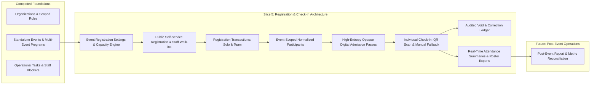
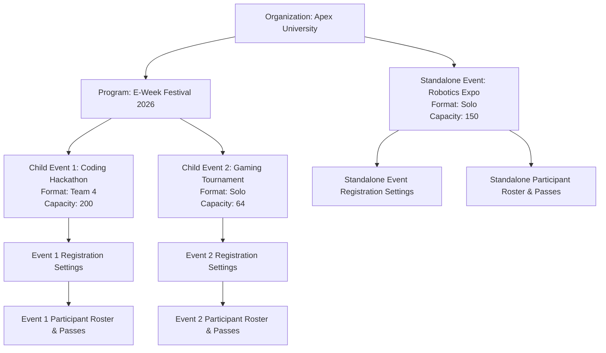
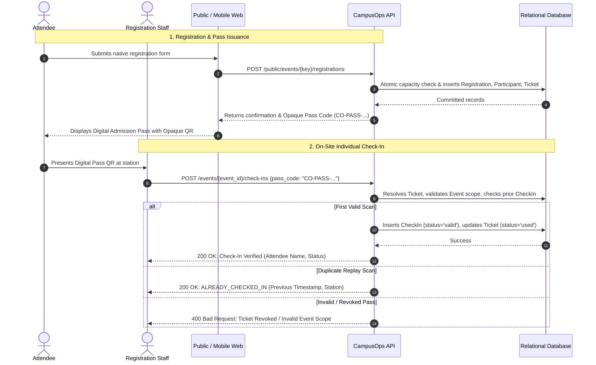
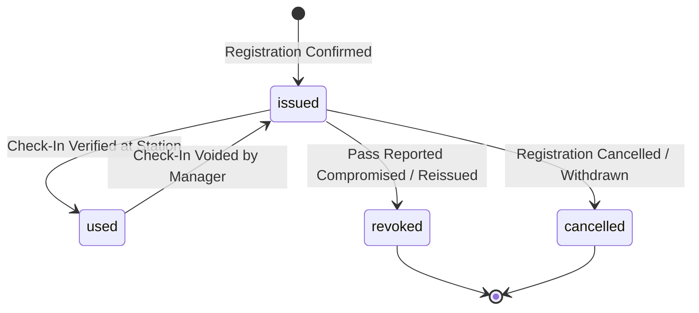
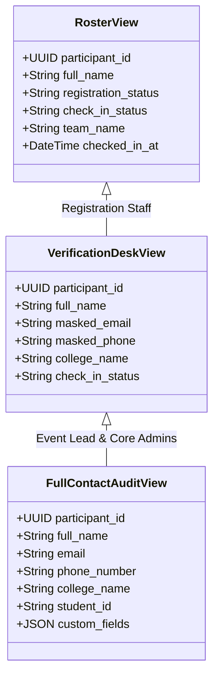

# CampusOps — Slice 5 Scope and Architecture Plan: Native Registration, Ticketing & Attendance Check-In

**Date:** 29 October 2026  
**Status:** Architecture & Design Plan (Slice 5A — Design Only)  
**Authoritative Context:** `Consolidated Documentation/CampusOps_PRD_v1.1.md` (CO-FR-008, CO-FR-009, FA-005, FA-007), `CampusOps_Technical_Specification_v1.1.md` Section 3.4, `CampusOps_Data_Model_and_Relationship_Map_v0.1.md` Section 8, and `CampusOps_Role_and_Permission_Matrix_v0.1.md` Section 9.

---

## 1. Executive Summary & Architectural Positioning

Development Slice 5 introduces **Native Participant Registration, Non-Payment Admission Pass Issuance (Ticketing), and Individual Attendance Check-In** to CampusOps.

Within the CampusOps modular monolith, Slice 5 completes the operational bridge between pre-event preparation (Programs, Events, Departments, and Task Workflows from Slices 3 and 4) and post-event documentation (Close-out checklists and reporting in Slice 6).



### 1.1 Core Invariants & Architectural Principles
1. **Separation of Concerns:** 
   - A **Registration Transaction** (`Registration`) is an administrative submission header (capturing entry type, submitter identity, timestamps, and capacity consumption).
   - An **Attendee Record** (`Participant`) represents an individual human expected to attend a specific event.
   - An **Admission Pass** (`Ticket` / `AdmissionPass`) is an opaque, secure, non-payment digital credential issued to an individual participant.
   - An **Attendance Record** (`CheckIn`) represents the physical, verified presence of an individual participant at an event station.
2. **Individual Check-In Rule (CO-FR-009 / FA-005):**
   - Every participant is checked in individually, regardless of whether they registered as a solo attendee or as part of a team.
   - Checking in one team member or scanning a team entry credential must **never** mark other team members present automatically.
3. **Non-Payment Admission Passes:**
   - Ticketing in Slice 5 is strictly a **digital admission credential** (boarding pass). Payment gateways, paid tickets, ticket tiers, currency processing, and refunds are explicitly **out of scope** for the initial release.
4. **Online-First with Documented Manual Fallback (FA-006):**
   - The operational posture is online-first. Stations communicate directly with the backend API.
   - No offline mesh synchronization or client-side peer-to-peer reconciliation is promised. If network connectivity fails, staff use an authorized printed roster or local snapshot for manual verification, followed by audited server-side reconciliation upon reconnect.
5. **Privacy & Data Minimization (CO-SEC-003 / FA-003):**
   - Participants do not create internal CampusOps workspace accounts.
   - Attendee contact information (`email`, `phone_number`) is strictly partitioned from general member directories and is accessible only to staff holding explicit operational authorization (`ACTION_VIEW_ATTENDEE_CONTACT`).
   - QR codes encode **zero PII**; they contain only high-entropy opaque pass tokens.

---

## 2. Product Scope & Functional Capabilities

### 2.1 In-Scope Capabilities
1. **Event Registration Configuration:**
   - Event-level activation of native registration (`is_open`, `registration_open_at`, `registration_close_at`).
   - Capacity management (`capacity_limit`, atomic reservation, registration cutoff).
   - Format configuration: `solo_only`, `team_only`, or `both`.
   - Team sizing rules: `min_team_size` and `max_team_size` (e.g. 2 to 4 members for a Hackathon).
2. **Public Native Self-Service Registration:**
   - Solo participant registration.
   - Team registration with primary team lead contact and individual member roster collection.
   - Duplicate prevention (rejecting duplicate active emails per event).
   - Rate limiting, bot abuse protection, and public key obfuscation on public endpoints.
3. **Staff-Assisted Walk-In Registration:**
   - Dedicated staff-side registration endpoint for on-site attendees arriving on event day.
   - Enforces the same underlying normalization and schema invariants as public registration.
   - Distinct audit tagging (`registration_channel = 'walk_in'`).
4. **Digital Admission Pass Issuance (Ticketing):**
   - Instant issuance upon confirmed registration.
   - Generation of high-entropy opaque ticket pass codes (`CO-PASS-<UUID4>`).
   - Pass status tracking: `issued`, `used`, `revoked`, `cancelled`.
   - Reissuance and revocation workflows preserving historical audit records.
5. **Individual Attendance Check-In:**
   - **Station QR Scan Workflow:** Fast camera/scanner lookup of opaque pass codes.
   - **Search-Based Manual Fallback:** Name or email search across the authorized event roster.
   - Server-side validation of event scope, pass validity, and prior check-in status.
   - Idempotent duplicate check-in handling: Repeated scans display a clear `"Already Checked In"` alert with prior timestamp and station, without incrementing attendance counts.
6. **Audited Check-In Corrections & Voids:**
   - Authorized correction of accidental check-ins (e.g. mistaken manual selection of wrong participant).
   - Voids require a mandatory audit reason, recording actor, timestamp, previous status (`valid`), and new status (`voided`). Physical deletion of records is forbidden.
7. **Participant Roster & Reporting:**
   - Searchable, filterable event participant roster (`confirmed`, `waitlisted`, `cancelled`, `checked_in`).
   - Real-time event attendance summary: total registered, total confirmed, total attended, attendance percentage, check-in velocity.
   - Scoped data export (CSV) gated behind explicit export permissions.

### 2.2 Strict Out-of-Scope Exclusions
1. **Paid Ticketing & Payment Gateways:** Zero Stripe/Razorpay integration, zero fee collection, zero refund workflows, zero invoice generation.
2. **External Integration Execution:** Zero automated Google Forms sync jobs, zero Google Sheets pollers, zero third-party CSV import workers in Slice 5. The data model provides source-tracking extension points, but live external connectors are deferred.
3. **Attendee Portal & Participant Accounts:** Zero participant logins, zero attendee password creation, zero attendee-facing issue/doubt ticketing portals.
4. **Marketing & Promotional Campaigns:** Zero email newsletters, zero social media publishing, zero promotional blast mechanisms.
5. **Client-Side Offline Mesh Sync:** Zero client-side SQLite/IndexedDB synchronization engines.

---

## 3. Operational Hierarchy & Scoping Model

### 3.1 Event-Scoped Registration Model
In CampusOps, **registration is strictly event-scoped**, not program-scoped:
- **Standalone Events:** Registration is configured directly on the standalone `Event`. All capacity limits, rosters, tickets, and check-in records belong to that event.
- **Child Events in Multi-Event Programs:** Each child event represents a distinct operational session (e.g. "AI Hackathon", "Robotics Maze Challenge", "Keynote Lecture") with its own venue, capacity, rules, and roster. Registration is conducted **per child event**.
- **Rationale:** A multi-event festival (e.g. E-Week) cannot use a single monolithic registration because child events have fundamentally conflicting formats (Hackathon requires teams of 4; Keynote is solo seating of 500; Workshop is capped at 30). Program-level "all-access festival wristbands" are an open product question, but relational integrity requires explicit event-level registration and individual check-in tracking.



### 3.2 Tenant Isolation & Scope Boundaries
- **Tenant Isolation:** Every registration, participant, ticket, check-in, and correction record carries a foreign key to `organization_id`. Database composite foreign keys enforce that child operational records strictly belong to the same organization as the event.
- **Cross-Event Sibling Isolation:** An Event Lead assigned to Event 1 has zero authority to view rosters, scan passes, or perform check-ins for Event 2, even within the same parent Program.
- **Public URL Obfuscation:** Public registration endpoints use a high-entropy, random `public_event_key` (UUIDv4) rather than internal integer IDs or standard UUIDs, preventing automated crawling and sequential enumeration.

---

## 4. Digital Admission Pass Architecture (Ticketing Without Payments)

### 4.1 Admission Pass Credential Design
1. **Opaque High-Entropy Token:**
   - When a registration is confirmed, CampusOps generates an unguessable, cryptographically random token:
     `pass_code = f"CO-PASS-{uuid.uuid4().hex.upper()}"` (128 bits of entropy).
   - This pass code is stored in `tickets.pass_code` (indexed with unique constraint).
2. **Digital Pass Display & QR Code Encoding:**
   - The attendee receives a confirmed registration response containing their pass code and a secure retrieval URL:
     `https://campusops.internal/passes/{pass_code}`.
   - When rendered on a web page or mobile screen, the QR code encodes **only the raw pass code or retrieval URL**.
   - **Zero PII in QR Code:** The QR code does not contain participant names, email addresses, phone numbers, or student IDs. Even if a QR code is photographed over someone's shoulder, no personal contact data is exposed.
3. **Server-Side Verification Protocol:**
   - The scanner station posts the scanned token to the check-in API:
     `POST /api/v1/organizations/{org_id}/events/{event_id}/check-ins {"pass_code": "CO-PASS-A1B2C3D4..."}`.
   - The backend resolves the pass record, asserts `ticket.event_id == event_id`, checks `ticket.status == 'issued'`, resolves the associated `Participant`, and evaluates check-in eligibility in a single atomic transaction.



### 4.2 Pass Lifecycle State Machine



- **`issued`:** Pass is active, valid, and awaiting arrival at the event.
- **`used`:** Pass was scanned and verified at a check-in station; participant is marked present.
- **`cancelled`:** Registration was cancelled or refunded; pass is permanently invalidated.
- **`revoked`:** Pass was reissued or invalidated due to suspected compromise; superseded by a new pass.

---

## 5. Registration Lifecycle & Capacity Concurrency Engine

### 5.1 Registration Capacity Enforcement Strategy
1. **Capacity Unit Definition (D-SLICE5-01):**
   - **Capacity is measured in individual human participants**, not registration headers or team entries.
   - A solo registration consumes **1 capacity slot**.
   - A team registration with 4 members consumes **4 capacity slots**.
2. **Race Condition Prevention at Capacity Limit:**
   - When an event has remaining capacity of 2 slots and two concurrent requests arrive (one team of 4, one solo of 1), the team of 4 must be rejected for insufficient capacity, while the solo registration succeeds.
   - **Database Concurrency Control:**
     - In PostgreSQL: `SELECT current_confirmed_count, capacity_limit FROM event_registration_settings WHERE event_id = :id FOR UPDATE;`
     - In SQLite / Dialect-Neutral: Atomic conditional update on the settings row:
       ```sql
       UPDATE event_registration_settings 
       SET current_confirmed_count = current_confirmed_count + :slots
       WHERE event_id = :event_id 
         AND is_open = 1 
         AND (capacity_limit IS NULL OR current_confirmed_count + :slots <= capacity_limit);
       ```
     - If `rowcount == 0`, capacity was exhausted or registration closed concurrently. The transaction rolls back cleanly and returns `HTTP 400 Bad Request` with `"Event capacity has been reached."`.

### 5.2 Team Registration Sizing & Invariants
- Event registration settings specify `team_size_min` and `team_size_max`.
- Submissions must supply roster details (`full_name`, `email`) for at least `team_size_min` and at most `team_size_max` distinct individuals.
- Incomplete team rosters (e.g. submitting only 1 person for a minimum-3 event) are rejected with `HTTP 422 Unprocessable Entity`.
- Duplicate emails within the same team submission (e.g. submitting the same person twice) are rejected.

---

## 6. Attendance Check-In & Audited Correction Architecture

### 6.1 Individual Attendance Check-In Verification Invariants
1. **Strict 1:1 Attendance Relationship:**
   - Attendance is tracked per `(event_id, participant_id)`.
   - Partial unique index `uq_check_in_active` on `(event_id, participant_id)` WHERE `check_in_status = 'valid'` prevents duplicate active attendance records at the database level.
2. **Duplicate Scan Idempotency:**
   - Repeated scans of the same pass or repeated manual selections return a successful HTTP response with `status: "already_checked_in"`, displaying the original check-in timestamp, station identifier, and checking staff member.
   - Duplicate attempts never insert secondary check-in rows or increment the attendance counter.
3. **Manual Fallback Search Engine:**
   - If an attendee's device battery dies or the screen is cracked, staff query `GET /events/{event_id}/check-in-lookup?q=Doe`.
   - The query matches against normalized name or email prefix, returning matching participant summaries (with masked private contact fields).
   - Staff select the verified attendee and call `POST /events/{event_id}/check-ins` with `participant_id` and `method = 'manual_search'`.

### 6.2 Check-In Void & Correction Protocol
- If staff mistakenly check in "Jane Doe" instead of "Janet Doe", an authorized manager (`PRIMARY_ADMIN`, `OFFICE_BEARER`, or `EVENT_LEAD`) can void the mistake.
- **Endpoint:** `POST /api/v1/organizations/{org_id}/events/{event_id}/check-ins/{check_in_id}/void`
- **Request Body:**
  ```json
  {
    "reason": "Staff clicked wrong attendee in search lookup; attendee confirmed not present."
  }
  ```
- **Execution:**
  1. Verifies caller holds `ACTION_CORRECT_CHECK_IN`. Ordinary registration desk staff are denied (HTTP 403).
  2. Updates `check_ins.check_in_status = 'voided'`, `check_ins.voided_at = now`, `check_ins.voided_by_user_id = caller.id`.
  3. Inserts an immutable audit record in `check_in_corrections` documenting the transition.
  4. Reverts the associated `Ticket.status` from `'used'` back to `'issued'`.
  5. Decrements `event_registration_settings.current_attended_count`.

---

## 7. Privacy, Data Minimization & Role-Based Contact Disclosure



1. **Tiered Field Disclosure Controls:**
   - **Public / Unauthenticated:** Sees zero roster information, zero participant data.
   - **General Workspace Members / Coordinators:** Access restricted to high-level counts (`total_registered`, `total_attended`).
   - **Registration Desk Staff (`ACTION_CHECK_IN`):** Sees name, check-in status, team name, and masked contact details (e.g. `j***@college.edu`, `***-***-1234`) strictly for verification.
   - **Event Leads & Core Admins (`ACTION_VIEW_ATTENDEE_CONTACT`):** Full access to unmasked contact information for logistics and emergency communication.
2. **Export Boundaries (`ACTION_EXPORT_PARTICIPANTS`):**
   - Full CSV roster exports containing attendee emails and phone numbers require explicit export permission.
   - Every export event is recorded in the organization audit log (`actor_id`, `event_id`, `export_format`, `record_count`, `timestamp`).

---

## 8. Prioritized Open Founder Decisions & Grounded Defaults

The following product-policy questions are formally identified for founder review, along with recommended initial-release defaults:

| Decision ID | Open Product-Policy Question | Evaluated Options | Recommended Initial-Release Default | Founder Approval Required? |
| :--- | :--- | :--- | :--- | :---: |
| **D-SLICE5-01** | **Capacity Measurement Metric** | Option A: Count individual human participants.<br>Option B: Count registration transactions.<br>Option C: Count teams as 1 unit. | **Option A (Individual Human Participants):** Fire safety, venue seating, catering, and security are constrained by physical bodies in the room. A team of 4 consumes 4 seats. | Yes (Grounded Default) |
| **D-SLICE5-02** | **Waitlist Promotion Automation** | Option A: Automatic promotion upon cancellation.<br>Option B: Manual staff-controlled promotion. | **Option B (Manual Staff Promotion):** Automatic promotion risks issuing passes to attendees who have made alternative plans or cannot attend on short notice, resulting in vacant seats. | Yes (Grounded Default) |
| **D-SLICE5-03** | **Check-In Correction Authority** | Option A: Any desk volunteer can void check-ins.<br>Option B: Only Event Leads and Office Bearers can void check-ins. | **Option B (Manager Only):** Prevents desk volunteers from accidentally or maliciously erasing attendance records without supervisory sign-off. | Yes (Grounded Default) |
| **D-SLICE5-04** | **Multi-Event Program Pass Model** | Option A: Event-scoped registrations only.<br>Option B: Unified Program festival passes with multi-event access. | **Option A (Event-Scoped Only):** Preserves modular integrity and distinct event capacities/venues. Program-wide passes deferred to a future pass-bundling slice. | Yes (Grounded Default) |

